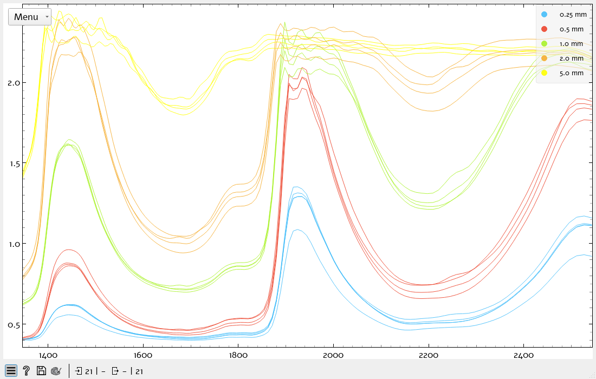
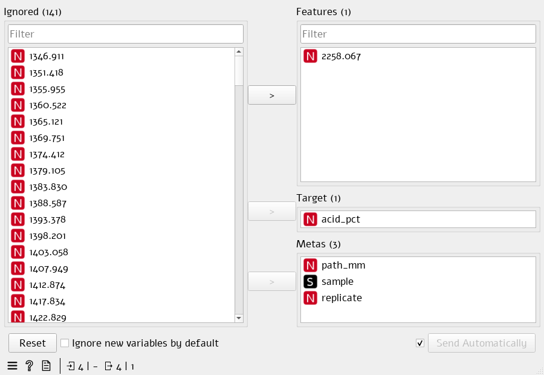
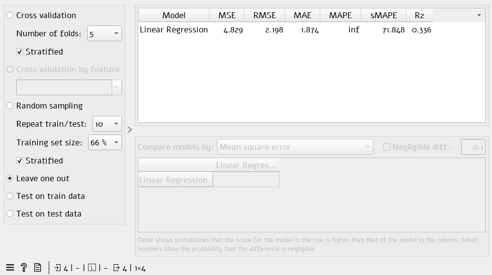
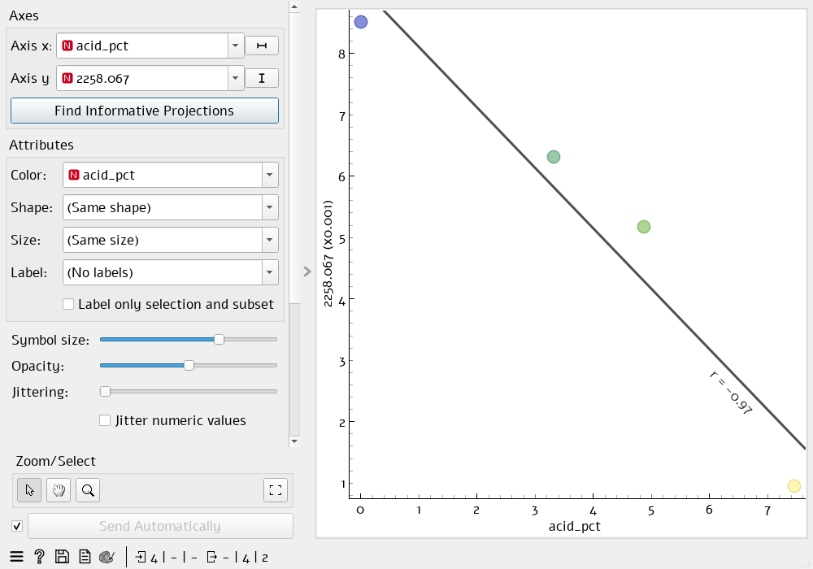

# 第 1 章 Orange 練習：光徑、飽和與單波長校正

> 測試版本：**Orange 3.40.0** + **Spectroscopy 外掛 0.9.2**（Windows 11）。
> 工作流程檔：`exercises/orange/ch01_pathlength.ows`；資料：`data/spectra_wide_orange.csv`。
> 下文的 widget 名稱一律照 Orange 3.40.0 英文介面原文書寫，括號內是中文說明。
> 安裝 Orange 與 Spectroscopy 外掛的步驟見 [README](README.md)。

本練習做兩件事：

- **看光譜**：把 21 條光譜（5 種光徑）畫在一起，找出偵測器「飽和平台」。
- **單波長校正**：只取 1 mm 的 4 條光譜，取二階導數，只留 2258 nm 一個波長，用線性迴歸做留一交叉驗證（Leave one out）。再把光徑換成 0.25、0.5、2、5 mm 比較。

所有設定（SG 視窗 9、二次、二階導數；2258 nm 與 1670 nm 兩個特徵帶）都是**事先依化學決定**的，跟 R / Python 練習相同。

> **先講清楚一件事**：Orange 的 **Linear Regression** 是「用訊號預測濃度」（直接迴歸），講義與 R / Python 練習是「用濃度預測訊號，再反推濃度」（反向校正）。兩者的 R² 完全相同，但留一法的 RMSE 不同。Orange 裡看到的 RMSE 不是講義上的 RMSECV，差別見第 5 節。

---

## 1. 開啟現成工作流程 ch01_pathlength.ows

1. **File → Open**，選 `exercises/orange/ch01_pathlength.ows`。
2. 畫布上有 8 個 widget，資料會自動流過整個工作流程：

```
File ─┬─ Formula (path label) ── Spectra (all 21)
      │
      └─ Select Rows (1 mm) ── Preprocess Spectra ── Select Columns (2258 nm) ─┬─ Linear Regression ─┐ (Learner)
                                                                              ├─────────────────────┴─ Test and Score (Data)
                                                                              └─ Scatter Plot
```

3. 雙擊 **Test and Score**（測試與評分），Linear Regression 那一列的 **RMSE 應為 2.198**（Leave one out）。

**關於資料路徑**：`.ows` 裡存的是**相對路徑** `../../data/spectra_wide_orange.csv`（相對於 `.ows` 所在資料夾）。只要保持下面的資料夾結構，搬到哪裡都能開：

```
（任意位置）/
├── data/spectra_wide_orange.csv
└── exercises/orange/ch01_pathlength.ows
```

我們已實測：把 `exercises/orange/` 與 `data/` 一起複製到別的資料夾後重新開啟，Orange 讀的是新位置的檔案，數字完全相同。如果 **File** widget 顯示紅色錯誤（找不到檔案），雙擊它，按資料夾圖示重新選 `data/spectra_wide_orange.csv` 即可。

> 注意：在 Orange 裡**另存**工作流程時，資料路徑會被改寫成你電腦上的絕對路徑。自己練習沒關係；要再發給別人時，請用原始的 `.ows`（或由老師用 `exercises/orange/tools/build_ch01_ows.py` 重新產生）。

---

## 2. 從零自己拉一次

操作方式：從左側面板把 widget 拖到畫布上；從一個 widget 右側的弧形接口拖到另一個 widget 左側接口，就會連線；雙擊 widget 開啟設定視窗。

### 步驟 1　File（讀檔）

- 拖一個 **File**（Data 類別），雙擊，按資料夾圖示選 `data/spectra_wide_orange.csv`。
- 資訊欄應顯示 **21 instances**、**142 features**（142 個波長）。
- `acid_pct` 的 Role 是 **target**（目標：Atago 11/02 實測酸度 0、3.32、4.87、7.45 %），`path_mm`、`sample`、`replicate` 是 **meta**（附加資訊，不參與計算）。角色已寫在 CSV 欄名旗標裡，不用改。
- 21 列 = 5 種光徑 × 4 個樣品，再加上 0.25 mm 的水多量一次（`replicate = 2`）。

### 步驟 2　Formula（公式）→ Spectra（光譜圖）：看飽和平台

**Spectra** 只能用「類別型」變數上色，而 `path_mm` 是數值，所以先用 **Formula** 做一個文字版的光徑標籤：

- 拖一個 **Formula**（Transform 類別），從 File 連過來。
- 按 **New → Categorical**，名稱填 `path`，運算式填 `str(path_mm) + ' mm'`，**Values (optional)** 留空，勾選 **Meta attribute**，按 **Send**。
- 拖一個 **Spectra**（Spectroscopy 類別），從 Formula 連過來。左上 **Menu → Color by → path**。



觀察重點：

- 5 mm（黃）在 1400–1550 nm 與 1900 nm 以後都貼在 **A ≈ 2.2–2.4**，2 mm（橘）在 1450 nm 與 1900–2000 nm 也**被削平**在同一個高度：這是偵測器的天花板（飽和平台），不是樣品的真實吸收。平台上的數值幾乎不隨濃度變，拿來校正只會得到雜訊。
- 講義用 **A < 1.5** 當保守的線性上限。1 mm（綠）在 1900 nm 水帶的峰頂也超過 2.2；0.25 mm（藍）最高只到 1.35，全部在 1.5 以下。
- 各光徑最高吸光度（驗證腳本讀出）：0.25 mm 1.352、0.5 mm 2.093、1 mm 2.374、2 mm 2.398、5 mm 2.443。

### 步驟 3　Select Rows（選取列）：只留 1 mm

- 拖一個 **Select Rows**，從 **File** 連過來。
- 按 **Add Condition** 加兩個條件：`path_mm` **equals** `1`；`replicate` **equals** `1`。
- 輸出 **4** 列（水、3 %、5 %、10 % 瓶）。

> 換光徑：之後只要把 `1` 改成 `0.25`、`0.5`、`2` 或 `5`，整條工作流程會自動重算（`replicate = 1` 這個條件只對 0.25 mm 有作用，但一律留著）。

### 步驟 4　Preprocess Spectra（光譜前處理）：二階導數

- 拖一個 **Preprocess Spectra**（Spectroscopy 類別），從 Select Rows 連過來。
- **Add preprocessor… → Savitzky-Golay Filter**：Window **9**、Polynomial Order **2**、Derivative Order **2**。
- 勾選 **Commit Automatically**（預設**不會**自動送出）。

### 步驟 5　Select Columns（選取欄位）：只留 2258 nm

- 拖一個 **Select Columns**（Transform 類別），從 Preprocess Spectra 連過來。
- 在 **Features** 框按一下，`Ctrl + A` 全選，按 **<** 把 142 個波長全部移到左邊 **Ignored**。
- 在 Ignored 的 **Filter** 框輸入 `2258`，選 **2258.067**，按 **>** 移回 Features。
- 確認 **Target** 是 `acid_pct`，**Metas** 是 `path_mm`、`sample`、`replicate`。



> 2258 nm 在資料中最接近的波長是 **2258.067**；1670 nm 最接近的是 **1669.901**。換 1670 nm 時，把 2258.067 移回 Ignored，改把 1669.901 移到 Features。

### 步驟 6　Linear Regression（線性迴歸）

- 拖一個 **Linear Regression**（Model 類別），從 Select Columns 連過來。
- 設定維持預設：**No regularization**、勾選 **Fit intercept**。

### 步驟 7　Test and Score（測試與評分）

- 拖一個 **Test and Score**（Evaluate 類別），連兩條線：**Select Columns → Test and Score**（Data）、**Linear Regression → Test and Score**（Learner）。
- 左側選 **Leave one out**：RMSE = **2.198**。
- 再改選 **Test on train data**（用全部 4 點擬合、再用同樣 4 點評分）：R2 = **0.934**，這就是講義的校正 R² **0.9342**（Orange 只顯示到小數第 3 位）。



> **Leave one out 時顯示的 R2（0.336）不是校正 R²**。它是用 4 個「留一預測值」算的，跟講義的 0.9342 是兩回事。要看校正 R²，一定要切到 **Test on train data**。

### 步驟 8　Scatter Plot（散佈圖）：校正線

- 拖一個 **Scatter Plot**，從 Select Columns 連過來。**Axis x: acid_pct**，**Axis y: 2258.067**，勾選 **Show regression line**。
- 4 個點大致排成一條斜率為負的直線，圖上標 r = −0.97（r² = 0.934）。這張圖的方向（x = 濃度、y = 訊號）正是講義校正線的方向。



---

## 3. 預期結果

1 mm、2258 nm（工作流程存檔時的設定）：

| 項目 | 在哪裡看 | 預期值 |
|---|---|---|
| Select Rows 輸出列數 | 狀態列 | 4 |
| Linear Regression，Leave one out | Test and Score 的 RMSE | **2.198** |
| 同上，Test on train data | Test and Score 的 R2 | **0.934**（= 0.9342） |
| Leave one out 時的 R2 | Test and Score | 0.336（不是校正 R²，見上） |

換光徑（改 Select Rows）與波長（改 Select Columns）後，學生應該看到的數字。右邊兩欄是講義（`analysis/pathlength_metrics.csv`，反向校正）：

| 光徑 | 波長 | Orange RMSE（Leave one out，直接迴歸） | Orange R2（Test on train data） | 講義 RMSECV（反向校正） | 講義 R² |
|---|---|---|---|---|---|
| 0.25 mm | 2258 | 1.066 | 0.959 | 1.076 | 0.9589 |
| 0.5 mm | 2258 | 2.341 | 0.853 | 3.344 | 0.8533 |
| **1 mm** | **2258** | **2.198** | **0.934** | **2.182** | **0.9342** |
| 2 mm | 2258 | 1.132 | 0.950 | 1.223 | 0.9498 |
| 5 mm | 2258 | 4.967 | 0.323 | 17.16 | 0.3229 |
| 0.25 mm | 1670 | 3.154 | 0.855 | 3.712 | 0.855 |
| 0.5 mm | 1670 | 2.302 | 0.787 | 4.173 | 0.7873 |
| 1 mm | 1670 | 1.952 | 0.945 | 1.945 | 0.9448 |
| 2 mm | 1670 | 2.469 | 0.851 | 3.493 | 0.8508 |
| 5 mm | 1670 | 0.158 | 0.999 | 0.1577 | 0.999 |

- **R² 兩邊完全一致**（Orange 只顯示 3 位小數）。
- **RMSE 不一致是正常的**：方法不同，見下一節。不要拿 Orange 的 RMSE 去對講義的 RMSECV。

**數字怎麼驗證的**：用 Orange 3.40.0 自己的 scheme API 建立 `.ows`；再以 headless 方式（`QT_QPA_PLATFORM=offscreen`）重新載入 `.ows`，讓訊號流完後直接讀 Test and Score 表格。上表 20 格是在同一次載入中，直接改 Select Rows 的條件與 Select Columns 的特徵後讀出，並與 numpy 寫的同一套直接迴歸（`np.polyfit`）逐格比對，全部相同到小數第 3 位。另把 `exercises/orange/` 與 `data/` 複製到別的資料夾重新載入，結果相同。腳本：`exercises/orange/tools/build_ch01_ows.py`、`verify_ch01_ows.py`。

---

## 4. 常見陷阱

1. **Leave one out 下的 R2 不是校正 R²**：0.336 vs 0.934。校正 R² 請用 **Test on train data**。
2. **Preprocess Spectra 預設不自動送出**：改設定後要按 **Commit** 或勾 **Commit Automatically**。
3. **Select Columns 要把其他 141 個波長移到 Ignored**：留在 Features 的話，Linear Regression 會用 142 個變數去擬合 4 個點，結果沒有意義。狀態列應顯示輸出只有 1 個 feature。
4. **Spectra 不能用數值上色**：直接選 `path_mm` 選不到，要先用 Formula 做類別型的 `path`。
5. **0.25 mm 水有兩條**：沒加 `replicate = 1` 的話，0.25 mm 會有 5 列，數字跟講義對不上。
6. **Orange 的 LOO 順序 = 檔案列順序**（樣品名稱排序：10 %、3 %、5 %、水），R / Python 依濃度由小到大。要逐筆對照時用濃度對，不要用列號。1 mm、2258 nm 的逐筆預測（Orange，直接迴歸）：7.45 → 11.105、3.32 → 2.720、4.87 → 3.669、0 → 2.038。

---

## 5. 為什麼 Orange 的 RMSE 跟講義不一樣（直接迴歸 vs 反向校正）

- **講義（反向校正）**：濃度是已知的 x，訊號是 y。每一折用 3 點擬合 `d2 = a + b·c`，再把留下那一點的訊號代回去解出濃度 `c = (d2 − a) / b`。
- **Orange Linear Regression（直接迴歸）**：反過來把訊號當 x、濃度當 y，擬合 `c = a + b·d2`，直接算出濃度。
- 4 個點全部用上時，兩條線的 **R² 相同**（R² 就是相關係數的平方，跟誰當 x 無關）。但留一法每次只用 3 點，兩種擬合的直線不同，**預測就不同，RMSE 也不同**。
- 線性越好，兩者越接近（1 mm 2258 nm：2.198 vs 2.182；5 mm 1670 nm 兩者都是 0.158）。線性越差，差別越大：反向校正要除以斜率 b，斜率接近 0 時預測會爆掉（5 mm 2258 nm：**17.16**）；直接迴歸則會把預測往平均值拉，誤差有上限（同一格 **4.967**）。
- 所以 **Orange 的 RMSE 比較小，不代表模型比較好**。對照組：完全不看光譜、每次都猜「其餘 3 個樣品的平均」，1 mm 的 Leave one out RMSE 是 **3.596**（用 Orange 的 Constant 學習器算的；你可以拖一個 **Constant**（Model 類別）接到 Test and Score 的 Learner 自己看）。5 mm 2258 nm 的 4.967 比「只猜平均」還差。
- 本課程選光徑、報告 RMSECV 時一律用講義的反向校正數字；Orange 用來快速比較、看趨勢（哪個光徑、哪個波長比較好），結論相同：**1 mm 兼顧線性與靈敏度，5 mm 在 2258 nm 已經飽和**。

---

## 6. 與 R / Python 練習的對照

| 步驟 | Orange widget | R（`exercises/pathlength_exercise.R`） | Python（`exercises/pathlength_exercise.ipynb`） |
|---|---|---|---|
| 讀資料 | **File**（寬表 `spectra_wide_orange.csv`） | 讀長表 `spectra_long.csv` 再轉成每個光徑 4 × 142 矩陣 | 讀長表再 `pivot` |
| 看飽和 | **Formula** + **Spectra** | `matplot` 加 A = 1.5 虛線 | matplotlib |
| 選光徑 | **Select Rows** | 邏輯索引 | 布林遮罩 |
| 二階導數 | **Preprocess Spectra → Savitzky-Golay Filter** (9, 2, 2) | 手寫 `sg_coeffs()` / `sg_apply()` | `savgol_filter(X, 9, 2, deriv=2)` |
| 取一個波長 | **Select Columns**（2258.067） | `which.min(abs(wl - 2258))` | `np.argmin(abs(wl - 2258))` |
| 校正 R² | **Linear Regression** + **Test and Score → Test on train data** | 手寫 `fit_line()` 與 `lm()` | `np.polyfit` |
| LOOCV | **Test and Score → Leave one out**（直接迴歸） | `loocv()`（反向校正） | 同 R |
| 1 mm、2258 nm 結果 | R² 0.934，RMSE 2.198 | R² 0.9342，RMSECV 2.182 | R² 0.9342，RMSECV 2.182 |

R / Python 練習還有 Orange 沒有內建的部分（雜訊與 LOD、靈敏度比、可用波段的判斷、手刻 SG 係數），請到那邊完成。
