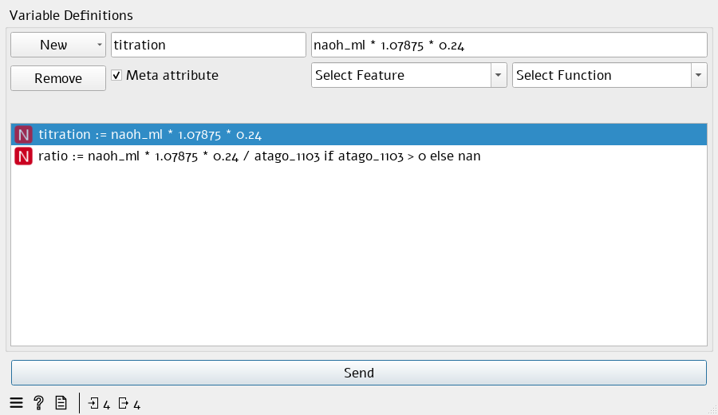
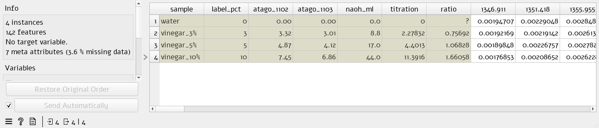
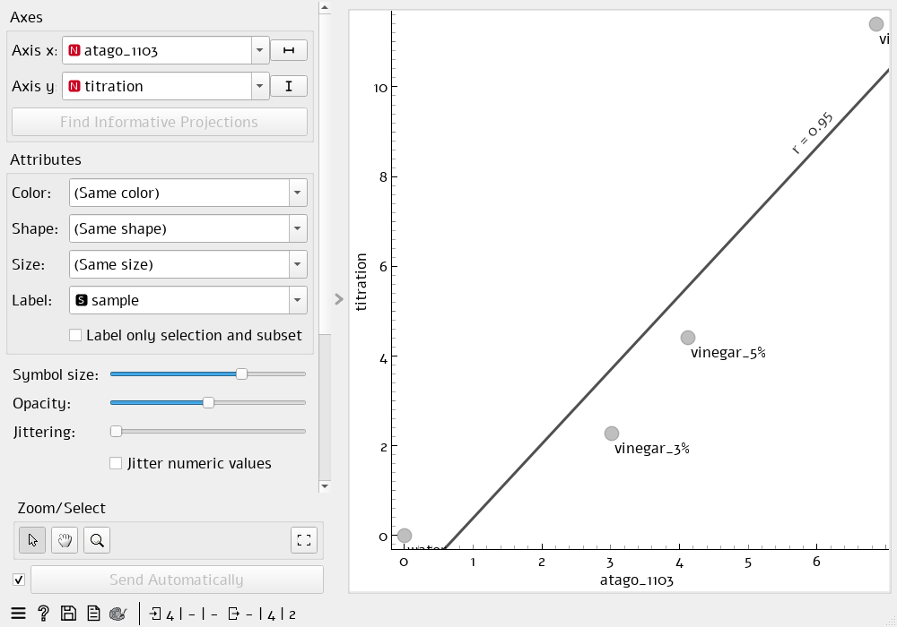
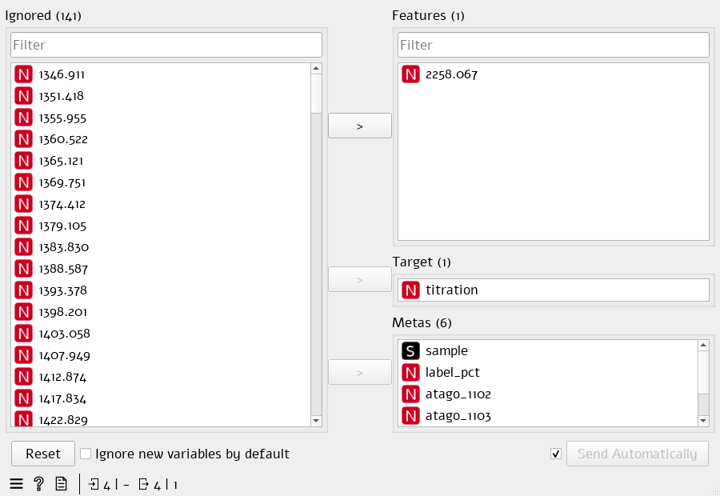
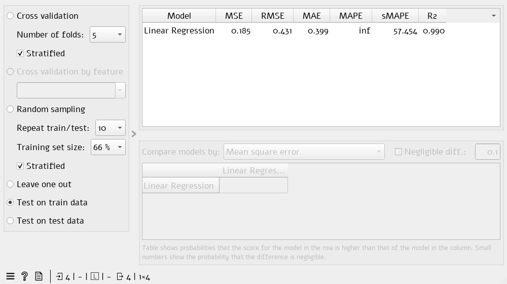

# 第 2 章 Orange 練習：參考值與實驗設計

> 測試版本：**Orange 3.40.0** + **Spectroscopy 外掛 0.9.2**（Windows 11）。
> 工作流程檔：`exercises/orange/ch02_references.ows`；資料：`data/spectra_1mm_refs_orange.csv`。
> 下文的 widget 名稱一律照 Orange 3.40.0 英文介面原文書寫，括號內是中文說明。
> 安裝 Orange 與 Spectroscopy 外掛的步驟見 [README](README.md)。

同樣 4 條 1 mm 光譜，換一組「參考值」（標示、滴定、兩天的 Atago），校正線的 R² 就不一樣。本練習用 Orange：

- 用 **Formula** 從 NaOH 滴定體積算出滴定酸度，以及滴定 / Atago 的比值；
- 用 **Select Columns** 輪流把 4 種參考值設成 target，看 2258 nm（與 1670 nm）的 R²。

> 本章看的是**校正 R²**（4 點全部用上），Orange 的 R² 與講義完全相同。Orange 的留一法 RMSE 用的是直接迴歸，與講義的反向校正不同，見 [第 1 章 Orange 講義](ch01_orange_guide.md) 第 5 節。

---

## 1. 資料檔

`data/spectra_1mm_refs_orange.csv`（由 `tools/nir-pathlength/make_orange_refs.py` 從 `data/spectra_long.csv` 產生）只有 4 列：1 mm、`replicate = 1` 的水與 3 瓶醋，列順序就是濃度由小到大。吸光度與 `spectra_wide_orange.csv` 的 1 mm 列逐值相同。

| 欄位 | 角色 | 水 | 3 % 瓶 | 5 % 瓶 | 10 % 瓶 |
|---|---|---|---|---|---|
| `sample` | meta（文字） | water | vinegar_3% | vinegar_5% | vinegar_10% |
| `label_pct` 瓶身標示 | meta | 0 | 3 | 5 | 10 |
| `atago_1102` Atago 11/02 | meta | 0 | 3.32 | 4.87 | 7.45 |
| `atago_1103` Atago 11/03 | meta | 0 | 3.01 | 4.12 | 6.86 |
| `naoh_ml` 滴定用掉的 0.1 N NaOH (mL) | meta | 0 | 8.8 | 17 | 44 |
| 1346.911 … 2542.337 | feature（142 個波長） | | | | |

**沒有預設 target**：所有參考值都放在 meta，要你自己在 Select Columns 指定。

---

## 2. 開啟現成工作流程 ch02_references.ows

1. **File → Open**，選 `exercises/orange/ch02_references.ows`。
2. 畫布上有 8 個 widget：

```
File ── Preprocess Spectra ── Formula (titration, ratio) ─┬─ Select Columns (2258 nm) ─┬─ Linear Regression ─┐ (Learner)
                                                          │                            └─────────────────────┴─ Test and Score (Data)
                                                          ├─ Data Table
                                                          └─ Scatter Plot
```

3. 雙擊 **Test and Score**：左側已選 **Test on train data**，Linear Regression 列的 **R2 = 0.990**（target = 滴定，講義 0.9898）。

**關於資料路徑**：`.ows` 存的是相對路徑 `../../data/spectra_1mm_refs_orange.csv`。保持 `data/` 與 `exercises/orange/` 的相對位置，搬到哪裡都能開（已實測複製到別的資料夾，數字相同）。找不到檔案時，雙擊 **File** 重新選檔即可。在 Orange 裡另存時路徑會變成絕對路徑，要發給別人請用原始 `.ows`（或用 `exercises/orange/tools/build_ch02_ows.py` 重新產生）。

---

## 3. 從零自己拉一次

### 步驟 1　File（讀檔）

- **File** 選 `data/spectra_1mm_refs_orange.csv`：**4 instances**、**142 features**、**No target variable**、5 個 meta。

### 步驟 2　Preprocess Spectra（二階導數）

- **Preprocess Spectra**，從 File 連過來。**Add preprocessor… → Savitzky-Golay Filter**：Window **9**、Polynomial Order **2**、Derivative Order **2**。勾選 **Commit Automatically**。
- 先做二階導數、再接 Formula：這樣新算出來的欄位不會被當成光譜去微分。

### 步驟 3　Formula（公式）：滴定酸度與比值

- 拖一個 **Formula**（Transform 類別），從 Preprocess Spectra 連過來。
- 按 **New → Numeric**，名稱 `titration`，運算式：

  ```
  naoh_ml * 1.07875 * 0.24
  ```

  勾選 **Meta attribute**。
  （酸度 g/100 mL = V × f × 0.006 × 100/25 ÷ 10 × 100 = V × f × 0.24；NaOH 力價 f = 1.07875。）
- 再按 **New → Numeric**，名稱 `ratio`，運算式：

  ```
  naoh_ml * 1.07875 * 0.24 / atago_1103 if atago_1103 > 0 else nan
  ```

  勾選 **Meta attribute**，按 **Send**。
  - 為什麼不寫 `titration / atago_1103`？同一個 Formula 裡的新欄位只能引用**輸入資料**已有的欄位，不能引用同一個視窗剛定義的 `titration`。要嘛寫完整式子，要嘛再接第二個 Formula。
  - 為什麼要 `if atago_1103 > 0 else nan`？水的 Atago 是 0，直接除會出現 **ZeroDivisionError**，整個 Formula 變紅、不輸出資料（我們實測過）。



### 步驟 4　Data Table（資料表）：看比值

- 拖一個 **Data Table**，從 Formula 連過來。



- `titration`：0、**2.278**、**4.401**、**11.392** %。
- `ratio`（滴定 / Atago 11/03）：水是 `?`（缺值），3 瓶醋 **0.757**、**1.068**、**1.661**（講義寫 0.76、1.07、1.66）。
- 比值**不是常數**：如果只是 NaOH 力價 f 算錯，3 瓶的比值會一起乘同一個數，不會從 0.76 爬到 1.66。所以滴定與 Atago 的差別不能用「力價誤差」解釋（Atago 在高濃度讀低；可能原因見講義第 2 章）。

### 步驟 5　Scatter Plot（散佈圖）：滴定 vs Atago

- **Scatter Plot**，從 Formula 連過來。**Axis x: atago_1103**、**Axis y: titration**，**Label: sample**，勾選 **Show regression line**。
- 點不在 y = x 上：低濃度滴定比 Atago 低、高濃度滴定比 Atago 高很多。



### 步驟 6　Select Columns（選取欄位）：選波長與 target

- **Select Columns**，從 Formula 連過來。
- Features 只留 **2258.067**（做法同第 1 章：全選 Features 移到 Ignored，再用 Filter 找 `2258` 移回來）。
- 從 **Metas** 把要當參考值的欄位（例如 `titration`）拖到 **Target**。其他參考值留在 Metas。



### 步驟 7　Linear Regression + Test and Score

- **Linear Regression**（預設設定），從 Select Columns 連過來。
- **Test and Score**：Select Columns → Data，Linear Regression → Learner。左側選 **Test on train data**，讀 **R2**。



### 步驟 8　輪流換 target、換波長

在 Select Columns 把 Target 換成另一個參考值（舊的拖回 Metas，新的拖進 Target），Test and Score 會自動重算。再把 2258.067 換成 **1669.901**（1670 nm）做一次。

---

## 4. 預期結果

1 mm、二階導數，Test and Score → **Test on train data** 的 R2（Orange 顯示 3 位小數；括號內為驗證腳本讀出的完整值）：

| Target（參考值） | 2258 nm：Orange | 2258 nm：講義 | 1670 nm：Orange | 1670 nm：講義 |
|---|---|---|---|---|
| `label_pct` 標示 0/3/5/10 | 0.996（0.99552） | 0.9955 | 0.998（0.99826） | 0.9983 |
| `titration` 滴定 0/2.28/4.40/11.39 | 0.990（0.98980） | 0.9898 | 0.987（0.98655） | 0.9866 |
| `atago_1103` Atago 11/03 | 0.956（0.95550） | 0.9555 | 0.963（0.96332） | 0.9633 |
| `atago_1102` Atago 11/02 | 0.934（0.93415） | 0.9342 | 0.945（0.94482） | 0.9448 |

8 格全部與講義（`site/nir-pathlength/ch02/index.html`、`exercises/ch02_reference_design.R`）一致。其他數字：

| 項目 | 預期值 |
|---|---|
| titration（3 瓶醋） | 2.278、4.401、11.392 % |
| ratio = titration / atago_1103 | 0.757、1.068、1.661（水：`?`） |
| 把 Formula 的 1.07875 改成 `1.07875 * 1.05`（假裝力價錯 5 %） | titration 變成 2.392、4.621、11.961，但 R2 仍是 **0.990**（0.9898，不變） |

最後一列說明：比例誤差只改變絕對值，不改變線性，所以 R² 完全不變。

> 若你想看留一法：把 Test and Score 切到 **Leave one out**，4 種參考值在 2258 nm 的 RMSE 依序是 0.666、1.225、1.636、2.198（1670 nm：0.392、1.458、1.426、1.952）。這是直接迴歸的數字，**不是**講義的 RMSECV；而且 4 種參考值的濃度範圍不同（標示到 10 %、滴定到 11.4 %），RMSE 不能直接拿來比哪個參考值好。

**數字怎麼驗證的**：用 Orange 3.40.0 自己的 scheme API 建立 `.ows`；以 headless 方式重新載入後讀 Formula 輸出與 Test and Score 表格；8 格 R² 是在同一次載入中直接改 Select Columns 的 target 與特徵後讀出，與講義的值比對（差距 < 0.00005）。力價 × 1.05 是直接改 Formula 的運算式後讀出。另把 `exercises/orange/` 與 `data/` 複製到別的資料夾重新載入，結果相同。腳本：`exercises/orange/tools/build_ch02_ows.py`、`verify_ch02_ows.py`；資料：`tools/nir-pathlength/make_orange_refs.py`。

---

## 5. 常見陷阱

1. **Formula 除以 0**：`ratio` 直接寫 `... / atago_1103` 會讓整個 Formula 出錯（水那一列 0 / 0）。要用 `if atago_1103 > 0 else nan`。
2. **Formula 新欄位要勾 Meta attribute**：沒勾的話 `titration`、`ratio` 會變成 feature，出現在 Select Columns 的 Features 框裡，模型就會拿「另一個參考值」去預測 target，數字沒有意義。新欄位一律設為 meta；要當 target 時再到 Select Columns 拖進 Target。
3. **先 Preprocess Spectra、再 Formula**：Preprocess Spectra 會把每一個 feature 當成光譜上的一點來微分。本工作流程先微分、再接 Formula，新欄位又是 meta，就不會混進光譜前處理。
4. **Target 一次只放一個參考值**：換參考值時，記得把舊的拖回 Metas，確認 Target 框裡只有一個變數，本表的數字是單一 target 的結果。
5. **R² 要看 Test on train data**：Leave one out 下的 R2 是留一預測的 R²，不是校正 R²。
6. **R² 高不代表參考值對**：標示值（0/3/5/10）R² 最高，但瓶身標示不是實測值。R² 只說明「光譜與這組數字排得多直」，不說明哪組數字才是真的酸度。

---

## 6. 與 R / Python 練習的對照

| 步驟 | Orange widget | R（`exercises/ch02_reference_design.R`） | Python（`exercises/ch02_reference_design.ipynb`） |
|---|---|---|---|
| 讀資料 | **File**（`spectra_1mm_refs_orange.csv`，4 列） | 讀長表 `spectra_long.csv`，取 1 mm | 同 R |
| 滴定酸度 | **Formula**：`naoh_ml * 1.07875 * 0.24` | `titration()` 函式 | 同 R |
| 比值 | **Formula** + **Data Table** | `ACID_TITR / ACID_ATAGO_1103[-1]` | 同 R |
| 二階導數 | **Preprocess Spectra → Savitzky-Golay Filter** (9, 2, 2) | 手寫 `sg_apply()` | `savgol_filter` |
| 換參考值 | **Select Columns** 換 Target | `REFS` 清單迴圈 | 同 R |
| 校正 R² | **Linear Regression** + **Test and Score → Test on train data** | `fit_line()` | `np.polyfit` |
| 結果 | 0.996 / 0.990 / 0.956 / 0.934（2258 nm） | 0.9955 / 0.9898 / 0.9555 / 0.9342 | 同 R |

R / Python 練習還有 Orange 做不到的部分：重複量測的雜訊（0.25 mm 水兩次）、水帶比值、蒙地卡羅模擬比較兩種實驗設計、10 mL 取樣量的滴定計算。請到那邊完成。
