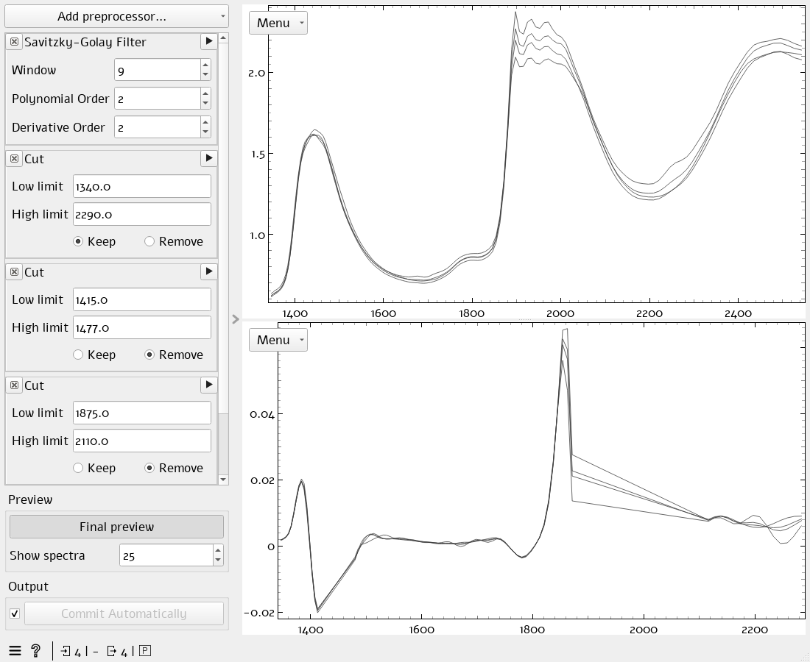
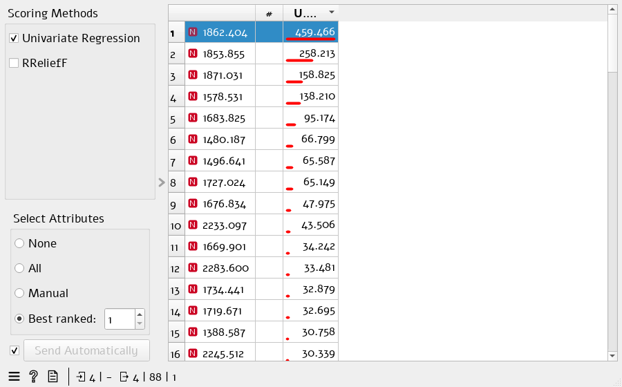
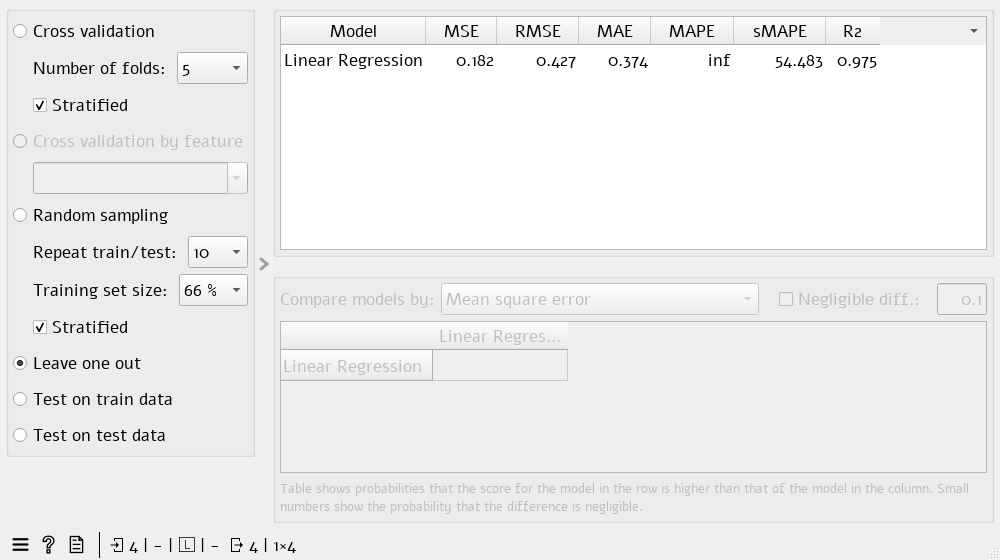
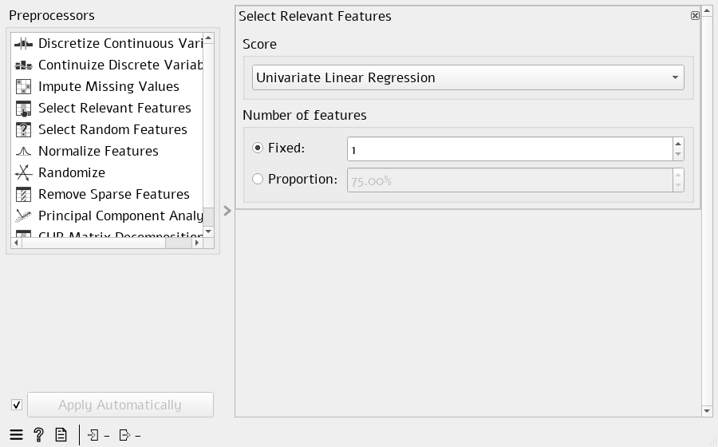
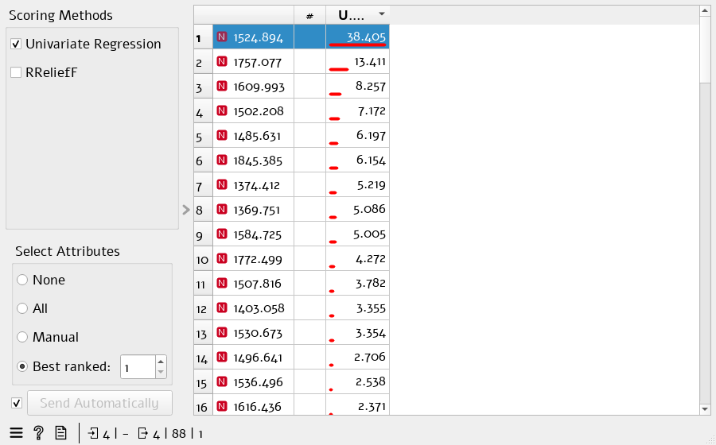

# 第 3 章 Orange 練習：波長挑選的陷阱

> 測試版本：**Orange 3.40.0** + **Spectroscopy 外掛 0.9.2**（Windows 11）。
> 工作流程檔：`exercises/orange/ch03_wavelength_pitfall.ows`；資料：`data/spectra_wide_orange.csv`。
> 下文的 widget 名稱一律照 Orange 3.40.0 英文介面原文書寫，括號內是中文說明。
> 安裝 Orange 與 Spectroscopy 外掛的步驟見 [README](README.md)。

只有 4 個樣品時，從 88 個可用波長裡挑「R² 最高」的那一個，再做留一交叉驗證，會發生什麼事？本練習在 Orange 裡把同一件事做兩次：

- **(A) 在交叉驗證外面挑**：先用全部 4 個樣品挑出最好的波長，再做 Leave one out。被留下的樣品其實已經參與過「挑」了（資訊洩漏）。
- **(B) 在交叉驗證裡面挑**：每一折只用 3 個訓練樣品重新挑波長，再預測被留下的那一個。這才是誠實的做法。

> Orange 的 **Linear Regression** 是直接迴歸（用訊號預測濃度），講義與 R / Python 是反向校正（用濃度預測訊號再反推）。本章兩種做法剛好非常接近（0.427 vs 0.432、2.578 vs 2.579），但仍不是同一個計算。差別見 [第 1 章 Orange 講義](ch01_orange_guide.md) 第 5 節。

---

## 1. 開啟現成工作流程 ch03_wavelength_pitfall.ows

1. **File → Open**，選 `exercises/orange/ch03_wavelength_pitfall.ows`。
2. 畫布上有 10 個 widget：

```
File ── Select Rows (1 mm) ── Preprocess Spectra (d2, 88 wl) ─┬─ Rank (outside CV) ──────────── Test and Score (A: outside)
                                                              │                                    ▲ Learner
                                                              │                 Linear Regression ─┤
                                                              │                                    ▼ Learner
                                                              ├──────────────────────────────────── Test and Score (B: inside)
                                                              │   Preprocess (select 1 inside CV) ──▲ Preprocessor
                                                              │
                                                              └─ Randomize (shuffle target) ── Rank (shuffled target)
```

3. 雙擊兩個 Test and Score：**(A) RMSE = 0.427**，**(B) RMSE = 2.578**。同樣的資料、同樣的模型，只差在「挑波長」放在哪裡，誤差差了 6 倍。

**關於資料路徑**：`.ows` 存的是相對路徑 `../../data/spectra_wide_orange.csv`，保持 `data/` 與 `exercises/orange/` 的相對位置即可（已實測複製到別的資料夾，數字相同）。找不到檔案時，雙擊 **File** 重新選檔。在 Orange 裡另存時路徑會變成絕對路徑，要發給別人請用原始 `.ows`（或用 `exercises/orange/tools/build_ch03_ows.py` 重新產生）。

---

## 2. 從零自己拉一次

### 步驟 1　File → Select Rows（只留 1 mm）

- **File** 選 `data/spectra_wide_orange.csv`（21 列、142 個波長，target = `acid_pct`）。
- **Select Rows**：`path_mm` **equals** `1`、`replicate` **equals** `1` → **4** 列。

### 步驟 2　Preprocess Spectra：二階導數 + 只留 88 個可用波長

講義的「可用波長」= 1 mm 的 4 條**原始**光譜吸光度**全部 < 1.5** 的波長，共 **88** 個，分成三段：1347–1413、1480–1871、2116–2284 nm。用 Cut 做出完全相同的範圍：

| 順序 | 前處理 | 設定 |
|---|---|---|
| 1 | **Savitzky-Golay Filter** | Window **9**、Polynomial Order **2**、Derivative Order **2** |
| 2 | **Cut** | Low limit **1340**、High limit **2290**、**Keep** |
| 3 | **Cut** | Low limit **1415**、High limit **1477**、**Remove**（1450 nm 水帶） |
| 4 | **Cut** | Low limit **1875**、High limit **2110**、**Remove**（1940 nm 水帶） |

- 勾選 **Commit Automatically**。
- 確認輸出剩 **88** 個 feature（狀態列或接一個 Data Table 看欄數）。驗證腳本確認過：這 88 個波長與「4 條原始光譜都 A < 1.5」的遮罩**逐一相同**。
- 先在完整光譜上微分、再切波段（理由同第 4 章：SG 需要前後各 4 個鄰點）。



### 步驟 3　(A) Rank（排序）：用 4 個樣品挑最好的波長

- 拖一個 **Rank**（Data 類別），從 Preprocess Spectra 連過來。
- **Scoring Methods** 只留 **Univariate Regression**，**取消勾選 RReliefF**（預設兩個都勾）。
- 確認表格依 **Univar. reg.** 欄**由大到小**排序（欄標題箭頭朝下；預設就是。若不是，按一下欄標題切換）。
- 左下 **Select Attributes** 選 **Best ranked: 1**。
- 第一名：**1862.404 nm**，分數 **459.466**。



> **Rank 顯示的是 F 值，不是 R²**。單一自變數的線性迴歸 F = R² / (1 − R²) × (n − 2)，n = 4 時換算回來 **R² = F / (F + 2)**：459.466 / 461.466 = **0.9957**，就是講義「可用波段最佳 1862.4 nm，R² = 0.9957」。F 與 R² 排序完全相同，所以挑到的第一名一樣。

### 步驟 4　(A) Test and Score：在 CV 外挑好之後才做留一

- **Linear Regression**（預設設定）。
- **Test and Score (A)**：**Rank → Test and Score**（Data，連線預設就是 Reduced Data，只含 1 個波長），**Linear Regression → Test and Score**（Learner）。選 **Leave one out**。
- **RMSE = 0.427**。



### 步驟 5　(B) Preprocess（前處理）：每一折重新挑

這一步用的是 Transform 類別裡一般的 **Preprocess**（前處理），**不是** Spectroscopy 的 Preprocess Spectra。

- 拖一個 **Preprocess**（Transform 類別）。**它不需要接資料輸入**：它送出的是「一個做法」（Preprocessor），由 Test and Score 在每一折執行。
- 從左側清單把 **Select Relevant Features**（選取相關特徵）拖到右邊。
  - **Score: Univariate Linear Regression**（下拉選單最後一個；除了 RReliefF，其他分數都是給類別型 target 用的）
  - **Number of features: Fixed: 1**
- 拖一個新的 **Test and Score (B)**，連三條線：
  - **Preprocess Spectra → Test and Score**（Data：全部 88 個波長）
  - **Linear Regression → Test and Score**（Learner）
  - **Preprocess → Test and Score**（Orange 會自動接到 **Preprocessor** 輸入）
- 選 **Leave one out**：**RMSE = 2.578**。




**為什麼這樣就是「在 CV 裡面挑」**：Test and Score 的 **Preprocessor** 輸入只套用在**每一折的訓練資料**上。Leave one out 每一折只有 3 個訓練樣品，所以「挑 R² 最高的 1 個波長」在每一折都只用這 3 個樣品重做一次，被留下的樣品完全沒參與。我們用兩種方法確認 Orange 真的逐折挑：(1) 用 numpy 寫同一套「每折重挑 + 直接迴歸」，RMSE 同為 2.578，逐筆誤差也相同；(2) 用 Orange API 對每一折的 3 個訓練樣品跑同一個 Select Relevant Features，四折挑到的波長是：

| 被留下的樣品（%） | 這一折挑到的波長（nm） | Orange 預測 − 真值 | 講義（反向校正） |
|---|---|---|---|
| 0 | 1853.855 | −1.144 | −1.147 |
| 3.32 | 1871.031 | +0.694 | +0.694 |
| 4.87 | 1796.146 | −4.168 | −4.169 |
| 7.45 | 2233.097 | +2.724 | +2.725 |

四折挑到四個不同的波長，跟講義完全相同。留下 4.87 % 時挑到 1796 nm，誤差 −4.2 %，主導了整個 RMSE。

### 步驟 6（選做）　Randomize → Rank：濃度亂排，還是挑得到高分

- 拖一個 **Randomize**（Transform 類別，隨機化），從 Preprocess Spectra 連過來。
  - **Shuffled columns** 只勾 **Classes**（只打亂 target），**Shuffled rows** 拉到 **100 %**，勾選 **Replicable shuffling**（可重現）。
- 再拖一個 **Rank**，從 Randomize 連過來，設定同步驟 3。
- 亂排後的濃度（檔案列順序）是 3.32、4.87、0、7.45（原本 7.45、3.32、4.87、0），4 個樣品的濃度全部錯位。
- Rank 第一名：**1524.894 nm**，F = **38.405** → R² = 38.405 / 40.405 = **0.9505**。濃度明明是亂的，從 88 個波長裡挑最好的，還是挑得到 R² > 0.95。（對照：固定用 2258 nm，這組亂排的 R² 只有 0.269，由 numpy 計算。）



> 這只是 24 種排列中的**一種**。取消勾選 Replicable shuffling 會得到另一種（每次不同、無法重現）。Orange 沒有「把 24 種排列全部跑一遍」的 widget；講義的完整洗牌檢驗（23 種錯誤排列中有 18 種挑得到 R² > 0.9，固定 2258 nm 只有 1 種）請到 R / Python 練習做。

---

## 3. 預期結果

| 項目 | 在哪裡看 | Orange | 講義（`ch03_wavelength_pitfall.R`，反向校正） |
|---|---|---|---|
| 可用波長數 | Preprocess Spectra 輸出 | 88 | 88 |
| 用 4 個樣品挑到的波長 | Rank (outside CV) | 1862.404 nm（F 459.466 → R² 0.9957） | 1862.4 nm，R² 0.9957 |
| (A) 在 CV 外挑，LOO RMSE | Test and Score (A) | **0.427** | 0.432（講義寫 0.43 %） |
| (B) 在 CV 內挑，LOO RMSE | Test and Score (B) | **2.578** | 2.579（講義寫 2.58 %） |
| (B) 四折挑到的波長 | 驗證腳本（Orange API） | 1853.9、1871.0、1796.1、2233.1 | 相同 |
| 亂排 target（Replicable）挑到的最佳 | Rank (shuffled target) | 1524.894 nm，F 38.405 → R² 0.9505 | （講義做 24 種全排列） |
| 固定 2258 nm 的 LOO RMSE（參考） | 第 1 章工作流程 | 2.198 | 2.182 |

- (A) 的逐筆誤差（Orange，直接迴歸）：7.45 → −0.305、3.32 → +0.409、4.87 → −0.103、0 → −0.677。講義（反向校正）：0 → −0.704、3.32 → +0.409、4.87 → −0.098、7.45 → −0.271。這裡兩種方法差比較多，所以 0.427 與 0.432 只是「剛好接近」，不是同一個數。
- Test and Score (A) 在 Leave one out 下顯示 R2 0.975，(B) 顯示 0.086：這是留一預測值的 R²，同樣說明 (A) 看起來很好、(B) 才是真相。
- 重點不是 0.427 這個數字本身，而是 **(A) 比 (B) 好 6 倍是假的**：挑選步驟必須放進交叉驗證裡面。誠實的 2.58 % 與「事先由化學決定、固定 2258 nm」的 2.18–2.20 % 差不多，挑波長並沒有換到更好的預測。

**數字怎麼驗證的**：用 Orange 3.40.0 自己的 scheme API 建立 `.ows`；以 headless 方式（`QT_QPA_PLATFORM=offscreen`）重新載入後，直接讀 Rank 表格與兩個 Test and Score 的表格與逐筆預測，並與 numpy 寫的同一套直接迴歸（在 CV 外挑 / 每折重挑）比對，RMSE 與逐筆誤差全部相同到小數第 3 位。88 個波長的名稱與 A < 1.5 遮罩逐一比對相同。另把 `exercises/orange/` 與 `data/` 複製到別的資料夾重新載入，結果相同。腳本：`exercises/orange/tools/build_ch03_ows.py`、`verify_ch03_ows.py`。

---

## 4. 常見陷阱

1. **Rank 的 RReliefF 預設是勾的**：只有 4 個樣品時 RReliefF 沒有意義，而且 Rank 的「Best ranked」是依**目前排序的那一欄**取前幾名。請取消 RReliefF，並確認是依 **Univar. reg.** 由大到小排序。
2. **Rank 的分數是 F 值**：要換成 R² 用 R² = F / (F + 2)（n = 4）。
3. **(B) 要用 Transform 類別的 Preprocess，不是 Preprocess Spectra**：只有前者能輸出 **Preprocessor** 給 Test and Score。Preprocess 不需要接資料；它送出的是「一個做法」，由 Test and Score 在每一折的訓練資料上執行。
4. **(B) 的 Data 要接 88 個波長的完整資料**，不是 Rank 的輸出。如果把 Rank 已經挑好的 1 個波長再丟進 (B)，Select Relevant Features 只能從 1 個裡面挑，結果就跟 (A) 一樣，等於沒修正洩漏。
5. **Select Relevant Features 的 Score 要選 Univariate Linear Regression**：下拉選單前面幾個（Information Gain、Gini…）是給類別型 target 用的；RReliefF 雖可用於數值 target，但不是講義的「R² 最高」準則。
6. **Cut 的範圍要完全照表**：少切或多切一點，可用波長就不是 88 個，Rank 挑到的波長與 RMSE 都可能不同。做完一定要確認 88。
7. **Orange 的 LOO 順序 = 檔案列順序**（10 %、3 %、5 %、水），R / Python 依濃度由小到大。逐筆比較請用濃度對照。
8. **Randomize 只給一種排列**：一次亂排挑到 R² 0.95 是「示範」，不是檢驗。要下結論需要全部 24 種排列（R / Python）。

---

## 5. 與 R / Python 練習的對照

| 步驟 | Orange widget | R（`exercises/ch03_wavelength_pitfall.R`） | Python（`exercises/ch03_wavelength_pitfall.ipynb`） |
|---|---|---|---|
| 1 mm、二階導數 | **Select Rows** + **Preprocess Spectra**（SG 9/2/2） | `sg_d2()` | `savgol_filter` |
| 可用波段 | 3 個 **Cut**（Keep 1340–2290，Remove 1415–1477、1875–2110） | `usable <- apply(X < 1.5, 2, all)` | `(X < 1.5).all(axis=0)` |
| 每個波長的 R² | **Rank**（Univariate Regression 的 F 值） | `r2_all()` | 同 R |
| (A) 在 CV 外挑 | **Rank** Best ranked 1 → **Test and Score** | `e_out`（`j_use` 固定） | 同 R |
| (B) 在 CV 內挑 | **Preprocess**（Select Relevant Features, 1）→ **Test and Score** 的 Preprocessor | `e_in`（每折 `best_idx()`） | 同 R |
| 校正方式 | **Linear Regression**（直接：c = a + b·d2） | `inv_pred()`（反向：d2 = a + b·c，再解 c） | 同 R |
| 洗牌檢驗 | **Randomize**（一種排列，示範） | 24 種全排列 | 同 R |
| 結果 | (A) 0.427、(B) 2.578 | (A) 0.432、(B) 2.579 | 同 R |

R / Python 練習還有 Orange 做不到的部分：24 種排列的完整洗牌檢驗、隨機資料的「最大 R²」模擬、把挑選池改成全部 142 個波長的比較。請到那邊完成。
