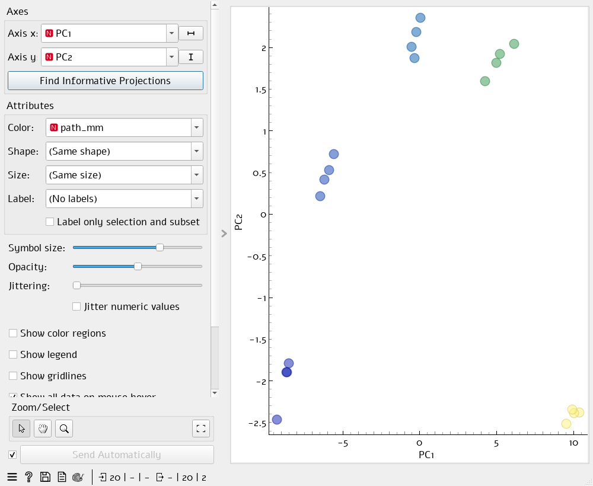
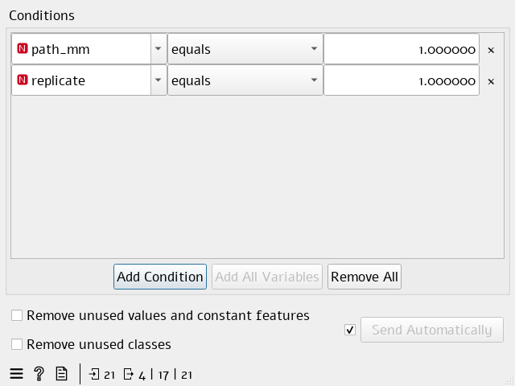
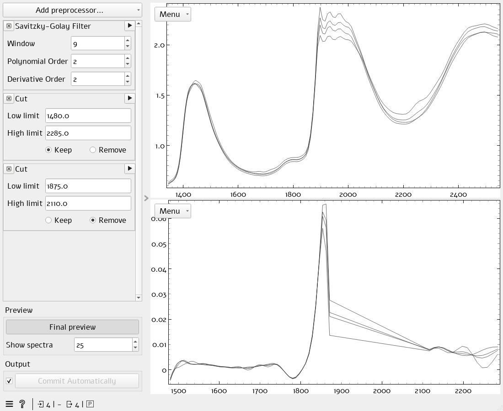
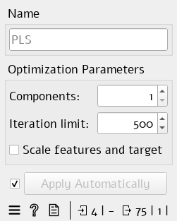
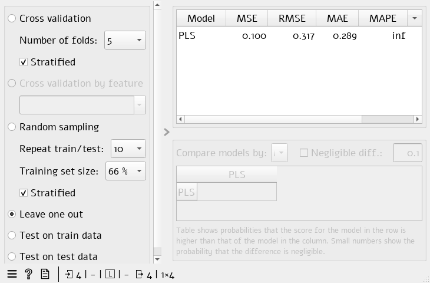

# 第 4 章 Orange 練習：用拖拉完成 PCA 與 PLS

> 測試版本：**Orange 3.40.0** + **Spectroscopy 外掛 0.9.2**（Windows 11）。
> 工作流程檔：`exercises/orange/ch04_pca_pls.ows`；資料：`data/spectra_wide_orange.csv`。
> 下文的 widget 名稱一律照 Orange 3.40.0 英文介面原文書寫，括號內是中文說明。

本練習做兩件事：

- **分支 A**：把 20 條原始光譜（5 種光徑 × 4 個樣品）丟進 PCA，看 PC1 抓到的是什麼。
- **分支 B**：只取 1 mm 的 4 條光譜，先取二階導數、再切出可用波段，接著做 PCA 與 PLS，最後用留一交叉驗證（Leave one out）算 RMSECV。

所有設定都是**事先固定**的，跟 R / Python 練習相同，不是看 RMSE 調出來的。請照著設定做，不要自己調參數去追更低的數字（理由見第 3 章）。

---

## 1. 安裝 Orange 與 Spectroscopy 外掛

1. 到 Orange 官網下載 Windows 版安裝程式並安裝（本講義用 3.40.0 測試）。
2. 開啟 Orange，選單 **Options → Add-ons…**（附加元件）。
3. 在清單中勾選 **Spectroscopy**，按 **OK**。Orange 會下載並安裝，完成後依提示**重新啟動 Orange**。
4. 重開後，左側 widget 面板會多出 **Spectroscopy** 類別，裡面有本練習要用的 **Preprocess Spectra**（光譜前處理）。

> 如果 Add-ons 視窗一直轉圈或失敗，通常是網路或防火牆擋住，換個網路再試；學校電腦可能需要用系統管理員權限安裝。

---

## 2. 開啟現成工作流程 ch04_pca_pls.ows

1. **File → Open**，選 `exercises/orange/ch04_pca_pls.ows`。
2. 畫布上會出現 9 個 widget，資料會自動流過整個工作流程：

```
File ─┬─ Select Rows (replicate = 1) ── PCA (20 raw spectra) ── Scatter Plot
      │
      └─ Select Rows (1 mm) ── Preprocess Spectra ─┬─ PCA (1 mm, 2nd derivative)
                                                   ├─ PLS ──────────┐ (Learner)
                                                   └────────────────┴─ Test and Score (Data)
```

3. 雙擊 **Test and Score**（測試與評分），表格中 PLS 那一列的 **RMSE 應為 0.317**。

**關於資料路徑**：`.ows` 裡存的是**相對路徑** `../../data/spectra_wide_orange.csv`（相對於 `.ows` 所在資料夾）。只要你搬動時保持這個資料夾結構：

```
（任意位置）/
├── data/spectra_wide_orange.csv
└── exercises/orange/ch04_pca_pls.ows
```

Orange 就會自己找到資料。我們已實測：把 `exercises/orange/` 與 `data/` 一起複製到別的資料夾後重新開啟，Orange 讀的是新位置的檔案，數字完全相同。

如果 **File** widget 顯示紅色錯誤（找不到檔案），雙擊它，按資料夾圖示重新選 `data/spectra_wide_orange.csv` 即可。

> 注意：Orange 的 **File** widget 只對「放在 `.ows` 同一資料夾或其子資料夾」的檔案保留相對路徑。我們的資料在上兩層，所以一旦你在 Orange 裡**另存**這個工作流程，路徑就會被改寫成你電腦上的絕對路徑。自己練習沒關係；要再發給別人時，請用原始的 `.ows`（或由老師用 `exercises/orange/tools/build_ch04_ows.py` 重新產生）。

---

## 3. 從零自己拉一次

建議先自己拉一次，再跟現成的 `.ows` 對照。操作方式：從左側面板把 widget 拖到畫布上；從一個 widget 右側的弧形接口拖到另一個 widget 左側接口，就會連線；雙擊 widget 開啟設定視窗。

### 步驟 1　File（讀檔）

- 拖一個 **File**（Data 類別），雙擊，按資料夾圖示選 `data/spectra_wide_orange.csv`。
- 檢查資訊欄：**21 instances**（21 列，每列一條光譜）、**142 features**（142 個波長）。
- 下方的欄位表中，`acid_pct` 的 Role 是 **target**（目標，醋酸濃度 %），`path_mm`、`sample`、`replicate` 是 **meta**（附加資訊，不參與計算）。這些角色已寫在 CSV 的欄名旗標裡（`cC#`、`mC#`、`mS#`），不用手動改。
- 為什麼是 21 列？0.25 mm 的水量了兩次（`replicate` = 1 與 2）。本章只用 `replicate = 1`，所以下一步要先篩掉多的那一條。

### 步驟 2　分支 A：Select Rows（選取列）→ 20 條原始光譜

- 拖一個 **Select Rows**（Data 類別），從 File 連過來。
- 按 **Add Condition**，設成：`replicate` **equals** `1`。
- 視窗底部狀態列應顯示輸入 21、輸出 **20**。

### 步驟 3　分支 A：PCA（主成分分析）

- 拖一個 **PCA**（Unsupervised 類別），從 Select Rows 連過來。
- **Components: 2**。
- **取消勾選 Normalize variables**（標準化變數）。光譜每個波長單位相同，只要置中、不要除以標準差；預設是勾選的，一定要取消。
- 右側圖中，紅線是各成分的變異比例，橄欖色是累積比例。在 Components = 2 時，圖上會標出 PC2 = **0.069**、累積 = **0.986**，所以 PC1 = 0.986 − 0.069 = **0.917**（也可以暫時把 Components 改成 1，直接看 0.917，看完改回 2）。

### 步驟 4　分支 A：Scatter Plot（散佈圖）

- 拖一個 **Scatter Plot**（Visualize 類別），從 PCA 連過來。
- **重點**：PCA 連到 Scatter Plot 時，Orange 預設接的是 `Data → Data`。請**雙擊這條連線**，改成 **Transformed Data → Data**（只含 PC1、PC2 與 meta 欄位）。
- 設定 **Axis x: PC1**、**Axis y: PC2**、**Color: path_mm**。
- 你會看到 5 群點，大致沿 PC1 由 0.25 mm 排到 5 mm（見 `img/ch04_orange_scatter.png`）。



### 步驟 5　分支 B：Select Rows（只留 1 mm）

- 再拖一個 **Select Rows**，也從 **File** 連過來（不是從分支 A 的 Select Rows）。
- 加兩個條件：
  - `path_mm` **equals** `1`
  - `replicate` **equals** `1`
- 輸出應為 **4** 列（水、3 %、5 %、10 % 醋各一條；濃度 0、3.32、4.87、7.45 %）。



### 步驟 6　分支 B：Preprocess Spectra（光譜前處理）

- 拖一個 **Preprocess Spectra**（Spectroscopy 類別），從步驟 5 的 Select Rows 連過來。
- 按 **Add preprocessor…**，依序加入三個步驟（清單由上往下就是執行順序，可拖曳調整）：

| 順序 | 前處理 | 設定 |
|---|---|---|
| 1 | **Savitzky-Golay Filter**（SG 平滑／微分） | Window **9**、Polynomial Order **2**、Derivative Order **2**（二階導數） |
| 2 | **Cut**（截取波段） | Low limit **1480**、High limit **2285**、選 **Keep**（保留範圍內） |
| 3 | **Cut**（截取波段） | Low limit **1875**、High limit **2110**、選 **Remove**（刪除範圍內：1 mm 在這段飽和） |

- 勾選底部的 **Commit Automatically**（自動送出），或改完設定後按一次 **Commit**。Preprocess Spectra 預設**不會**自動送出，沒按的話下游拿到的是舊結果。
- 結果：剩 **73 個波長**，分成 1480–1871 nm 與 2116–2284 nm 兩段。下方預覽圖中間那條斜直線只是繪圖把兩段連起來，不是資料。



### 步驟 7　分支 B：PCA（1 mm 二階導數）

- 拖一個 **PCA**，從 Preprocess Spectra 連過來。
- **Components: 2**，**取消勾選 Normalize variables**。
- PC1 應為 **0.969**（暫時把 Components 改成 1 即可在圖上看到）。

### 步驟 8　分支 B：PLS（偏最小平方迴歸）

- 拖一個 **PLS**（Model 類別），從 Preprocess Spectra 連過來。
- **Components: 1**。
- **取消勾選 Scale features and target**（縮放特徵與目標）。預設是勾選的，這是本章最大的陷阱（見第 5 節）。
- Iteration limit 維持預設 500。



### 步驟 9　分支 B：Test and Score（測試與評分）

- 拖一個 **Test and Score**（Evaluate 類別）。
- 連兩條線：
  - **Preprocess Spectra → Test and Score**（Data）
  - **PLS → Test and Score**（Learner，學習器）
- 左側選 **Leave one out**（留一法）。
- 右側表格 PLS 列：**RMSE = 0.317**（這就是 RMSECV，單位是 % 醋酸）。



---

## 4. 預期結果

| 項目 | 在哪裡看 | 預期值 |
|---|---|---|
| 分支 A 輸入列數 | Select Rows (replicate = 1) 狀態列 | 20 |
| 分支 A PCA 解釋變異 | PCA 圖 | PC1 **0.917**、PC2 **0.069**（累積 0.986） |
| \|corr(PC1, path_mm)\| | 由驗證腳本計算（Orange 介面無直接顯示） | **0.91**（PC1 主要反映光徑；與濃度的 \|r\| 只有 0.02） |
| 分支 B 列數／波長數 | Select Rows (1 mm)／Preprocess Spectra | 4 列、73 個波長（1480–1871、2116–2284 nm） |
| 分支 B PCA | PCA 圖 | PC1 **0.969**（PC2 0.028） |
| PLS LOO RMSE（1 成分、不縮放） | Test and Score | **0.317** |
| 同上，但勾選 Scale features and target | Test and Score | **2.458** |
| 不縮放、2 個成分 | Test and Score | **0.461** |

Test and Score 的 MAPE 會顯示 `inf`：因為水的濃度是 0，百分比誤差除以 0。這不是錯誤，看 RMSE 即可。

**數字怎麼驗證的**：我們用 Orange 3.40.0 自己的 scheme API（`orangecanvas` / `Orange.canvas`）建立 `.ows`，由 Orange 的 scheme writer 寫檔；再用 Orange 內建 headless 執行器相同的方式（`QT_QPA_PLATFORM=offscreen`）重新載入 `.ows`，讓訊號流完後，直接讀 PCA widget 的解釋變異與 Test and Score widget 表格中的 RMSE。2.458 與 0.461 是在同一次載入中，直接切換 PLS widget 的勾選框與成分數後讀出。另外把 `exercises/orange/` 與 `data/` 複製到別的資料夾重新載入，結果相同。上述數字與 `tools/nir-pathlength/make_data_ch04.py`（scikit-learn）以及 R、Python 練習一致。腳本放在 `exercises/orange/tools/`（`build_ch04_ows.py`、`verify_ch04_ows.py`）。

---

## 5. 常見陷阱

1. **PLS 的 Scale features and target 預設是勾選的** → RMSE 變成 **2.46 %**，比不縮放的 0.317 差了將近 8 倍。光譜每個波長單位相同，縮放會把只有雜訊的波長放大到跟訊號波長一樣重要。請務必取消勾選。
2. **PCA 的 Normalize variables 預設也是勾選的**。理由同上：光譜只要置中、不要標準化。勾著的話解釋變異會跟本講義對不上。
3. **Cut 一定要放在 Savitzky-Golay Filter 後面**。SG 在每個波長都要用前後各 4 個鄰點（window 9）。如果先 Cut 再微分，1480 nm 附近會出現邊緣效應；更糟的是 1871 nm 與 2116 nm 中間的 245 nm 空缺會被當成相鄰點一起微分，算出沒有物理意義的導數。正確順序：先在完整光譜上微分，再切波段。Preprocess Spectra 的清單由上往下執行，順序錯了就把 SG 拖回最上面。
4. **Cut 的 Keep / Remove 別選錯**：第一個 Cut 是 **Keep**（1480–2285），第二個是 **Remove**（1875–2110）。做完要確認剩 73 個波長。
5. **Preprocess Spectra 預設不自動送出**：改設定後要按 **Commit**，或勾選 **Commit Automatically**。
6. **PCA → Scatter Plot 的連線**：預設接 `Data`，請改成 `Transformed Data`，比較好選到 PC1、PC2。
7. **Orange 的 LOO 列順序跟 R / Python 不同，要用濃度對照**。Orange 依檔案中的列順序（樣品名稱排序：10 %、3 %、5 %、水），R / Python 依濃度由小到大。逐筆誤差（預測 − 真值）：

   | 濃度 (%) | Orange 預測 | 誤差 |
   |---|---|---|
   | 7.45 | 7.346 | −0.104 |
   | 3.32 | 3.572 | +0.252 |
   | 4.87 | 4.529 | −0.341 |
   | 0.00 | 0.460 | +0.460 |

   照濃度排好後，與 R / Python 的 `[0.460, 0.252, −0.341, −0.104]` 完全相同。想在 Orange 看逐筆預測，可從 Test and Score 接一個 **Predictions**（預測）widget。
8. **PC 的正負號是任意的**。PCA 的成分方向乘上 −1 是同一個解，所以你的散佈圖可能左右（或上下）顛倒，載荷與分數的正負也可能跟 R / Python 相反。比較時看**絕對值**與**排列順序**，不要看正負號。
9. **0.25 mm 水有兩條**：分支 A 忘了加 `replicate = 1` 的條件，會變成 21 列，PCA 的數字就跟講義對不上。（分支 B 只取 1 mm，1 mm 本來就只有一條，但條件照樣加上，跟 R / Python 保持一致。）

---

## 6. 與 R / Python 練習的對照

| 步驟 | Orange widget | R（`exercises/ch04_pca_pls.R`） | Python（`exercises/ch04_pca_pls.ipynb`） |
|---|---|---|---|
| 讀資料 | **File**（寬表 `spectra_wide_orange.csv`） | 讀長表 `spectra_long.csv` 再轉寬 | 讀長表再 `pivot` |
| 篩選 | **Select Rows** | 邏輯索引 | 布林遮罩 |
| PCA（只置中） | **PCA**，取消 Normalize variables | `prcomp(M, center = TRUE, scale. = FALSE)` | SVD（置中後） |
| 二階導數 | **Preprocess Spectra → Savitzky-Golay Filter** (9, 2, 2) | 手寫 `sg_d2()`（SG 9 點、二次、二階導數） | `savgol_filter(X, 9, 2, deriv=2)` |
| 波段 | **Cut** Keep 1480–2285 + **Cut** Remove 1875–2110 | 波長邏輯索引 | 波長遮罩 |
| PLS-1 | **PLS**，Components 1、取消 Scale features and target | 手寫 NIPALS，`scale = FALSE` | 手寫 NIPALS，`scale=False` |
| LOOCV | **Test and Score → Leave one out** | `pls_loocv()` | `pls_loocv()` |
| 結果 | RMSE 0.317 | RMSECV 0.317 | RMSECV 0.317 |

三種工具算出同一組數字（PCA 0.917 / 0.069、1 mm PC1 0.969、RMSECV 0.317；縮放 2.458；2 成分 0.461）。差別只在：R / Python 讓你看到每一步的程式碼，Orange 讓你用拖拉快速換設定、立刻看到結果。建議做法：先在 Orange 裡勾選 Scale features and target、改成 2 個成分，親眼看 RMSE 怎麼變；再回到 R / Python 練習，理解為什麼會這樣。

R / Python 練習還有 Orange 沒有內建的部分（打亂標籤的 24 種排列檢查、迴歸係數分析），請到那邊完成。
