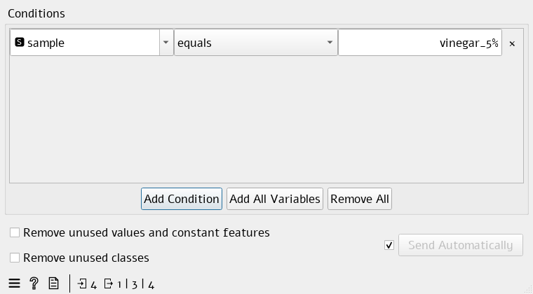
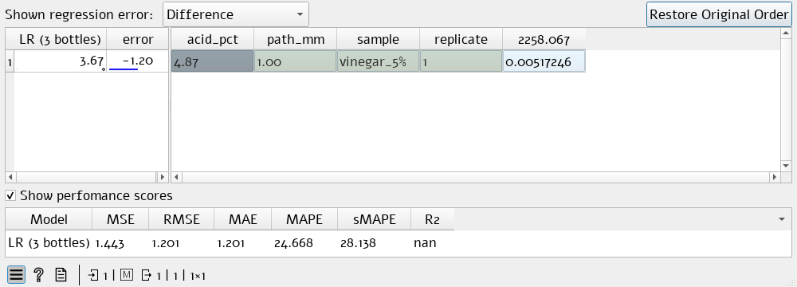
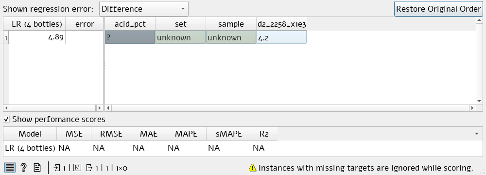
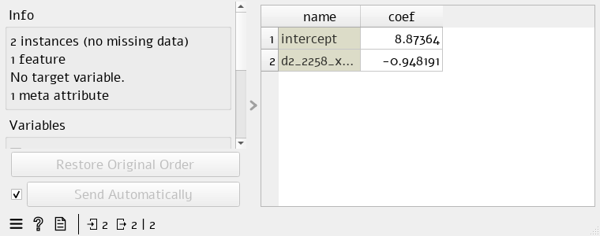

# 第 5 章 Orange 練習：預測未知樣品（只做點預測）

> 測試版本：**Orange 3.40.0** + **Spectroscopy 外掛 0.9.2**（Windows 11）。
> 工作流程檔：`exercises/orange/ch05_prediction.ows`；資料：`data/spectra_wide_orange.csv`、`data/unknown_2258_orange.csv`。
> 下文的 widget 名稱一律照 Orange 3.40.0 英文介面原文書寫，括號內是中文說明。
> 安裝 Orange 與 Spectroscopy 外掛的步驟見 [README](README.md)。

本練習做兩件事，設定與第 1 章相同（1 mm、重複 1、SG 9/2 二階導數、只用 2258 nm）：

- **A. 藏起一瓶**：把 4.87 % 那瓶當成「未知樣品」，只用其他 3 瓶建模型，再讓 **Predictions**（預測）算出它的酸度，跟真值 4.87 比。
- **B. 假想未知樣品**：用 4 瓶全部建模型，預測一個 2258 nm 二階導數訊號為 **4.20 × 10⁻³** 的未知樣品。

> **先講清楚兩件事**
>
> 1. **Orange 只能給點預測，給不出區間。** 第 5 章的重點是「預測值 ± 不確定度」（Fieller 精確區間），但 Orange 沒有校正預測區間的 widget。本練習只做到「預測值是多少」；區間請到 R / Python 練習（`exercises/ch05_prediction_uncertainty.R` 或 `.ipynb`）完成。
> 2. **Orange 的預測值跟講義不一樣。** Orange 的 **Linear Regression** 是直接迴歸（用訊號預測濃度，`c = a + b·訊號`）；講義是反向校正（`訊號 = a + b·c`，再反推 `c0 = (y0 − a)/b`）。兩者的預測值不同：A 是 3.669 vs 3.671，B 是 **4.891 vs 4.960**。報告時用講義的數字，原因見第 4 節。

---

## 1. 開啟現成工作流程 ch05_prediction.ows

1. **File → Open**，選 `exercises/orange/ch05_prediction.ows`。
2. 畫布上有 12 個 widget，分成上下兩條：

```
A  File ── Select Rows (1 mm) ── Preprocess Spectra ── Select Columns (2258 nm) ── Select Rows (hide 4.87 %)
   Select Rows (hide 4.87 %) ─ Unmatched Data（其他 3 瓶）→ Linear Regression (3 bottles) ─ Model ─→ Predictions (4.87 % bottle)
   Select Rows (hide 4.87 %) ─ Matching Data（4.87 % 瓶）─────────────────────────── Data ─→ Predictions (4.87 % bottle)

B  File (unknown 2258) ── Select Rows (set = unknown)
   Select Rows (set = unknown) ─ Unmatched Data（4 個校正點）→ Linear Regression (4 bottles) ─ Model ─→ Predictions (y0 = 4.20)
   Select Rows (set = unknown) ─ Matching Data（未知樣品）──────────────────────────── Data ─→ Predictions (y0 = 4.20)
   Linear Regression (4 bottles) ─ Coefficients → Data Table (coefficients)
```

3. 雙擊 **Predictions (4.87 % bottle)**：`LR (3 bottles)` 欄顯示 **3.67**，error 欄 **−1.20**（3.669 − 4.87）。
4. 雙擊 **Predictions (y0 = 4.20)**：`LR (4 bottles)` 欄顯示 **4.89**。

**關於資料路徑**：`.ows` 裡兩個 File 存的都是**相對路徑**（`../../data/spectra_wide_orange.csv`、`../../data/unknown_2258_orange.csv`）。保持下面的結構，搬到哪裡都能開：

```
（任意位置）/
├── data/
│   ├── spectra_wide_orange.csv
│   └── unknown_2258_orange.csv
└── exercises/orange/ch05_prediction.ows
```

我們已實測：把這三個檔案照上面的結構複製到別的資料夾後重新開啟，Orange 讀的是新位置的檔案，兩個預測值完全相同。如果 File widget 顯示紅色錯誤（找不到檔案），雙擊它重新選檔即可。在 Orange 裡**另存**後，資料路徑會變成你電腦上的絕對路徑；要發給別人請用原始的 `.ows`。

---

## 2. 從零自己拉一次

操作方式同第 1 章：從左側面板拖 widget 到畫布，從右側弧形接口拖到另一個 widget 的左側接口連線，雙擊開設定視窗。**改連線的輸出**：在連線上雙擊，會打開 **Edit Links** 視窗，可以拿掉原來那條、改拉別的輸出（下面的 Matching / Unmatched Data 會用到）。

### A. 藏起 4.87 % 那瓶

#### 步驟 1–4　File → Select Rows → Preprocess Spectra → Select Columns（同第 1 章）

- **File**：選 `data/spectra_wide_orange.csv`（21 instances、142 features）。
- **Select Rows**：`path_mm` **equals** `1`、`replicate` **equals** `1`，輸出 4 列。
- **Preprocess Spectra**：**Savitzky-Golay Filter**，Window **9**、Polynomial Order **2**、Derivative Order **2**；勾 **Commit Automatically**。
- **Select Columns**：Features 只留 **2258.067**，Target `acid_pct`，Metas `path_mm`、`sample`、`replicate`。

詳細畫面見[第 1 章講義](ch01_orange_guide.md)步驟 1–5。

#### 步驟 5　Select Rows（選取列）：把 4.87 % 那瓶分出來

- 再拖一個 **Select Rows**，從 **Select Columns** 連過來。
- **Add Condition**：`sample` **equals** `vinegar_5%`（這瓶 Atago 實測 4.87 %）。
- 狀態列顯示輸入 4 列、輸出 **1 | 3 | 4**：1 列符合（Matching Data）、3 列不符合（Unmatched Data），最後的 4 是加了標記欄的全部資料（Data 輸出，這裡用不到）。



> 這個 Select Rows 有兩個輸出：**Matching Data**（符合條件：4.87 % 那瓶）與 **Unmatched Data**（不符合：其他 3 瓶）。一個 widget 就同時得到「訓練組」和「未知樣品」，不必拉兩個 Select Rows。

#### 步驟 6　Linear Regression（線性迴歸）：只用 3 瓶

- 拖一個 **Linear Regression**，從步驟 5 的 Select Rows 連過來。Orange 預設連的是 **Matching Data**，這裡要改：在連線上雙擊打開 **Edit Links**，拿掉 Matching Data → Data，改拉 **Unmatched Data → Data**。連好後連線上的標籤應是 `Unmatched Data → Data`。
- 名稱可改成 `LR (3 bottles)`（Predictions 表頭會顯示這個名稱），其他維持預設：**No regularization**、勾 **Fit intercept**。

#### 步驟 7　Predictions（預測）：算出藏起那瓶的酸度

- 拖一個 **Predictions**（Evaluate 類別），連兩條線：
  - **Linear Regression → Predictions**：輸出 **Model** → 輸入 **Predictors**（直接連上就是這樣，不用改）。
  - **Select Rows（步驟 5）→ Predictions**：輸出 **Matching Data** → 輸入 **Data**。
- 雙擊 Predictions：左邊 `LR (3 bottles)` 欄是預測值 **3.67**，`error` 欄是 **−1.20**（預測 − 真值）；右邊是這一列原本的資料（`acid_pct` 4.87、`2258.067` 0.00517246）。



> 下方的 MSE、RMSE、R2 等分數是用**這 1 列**算的：RMSE 1.201 就是 |誤差|，R2 是 nan（1 個點算不出 R²）。不用理會。

### B. 4 瓶校正、假想未知樣品 y0 = 4.20 × 10⁻³

#### 步驟 8　File：讀 `data/unknown_2258_orange.csv`

- 拖第二個 **File**，選 `data/unknown_2258_orange.csv`。這個小檔只有 5 列、1 個特徵：

| set | sample | acid_pct（target） | d2_2258_x1e3（feature） |
|---|---|---|---|
| calibration | water | 0 | 8.508742 |
| calibration | vinegar_3% | 3.32 | 6.307329 |
| calibration | vinegar_5% | 4.87 | 5.172459 |
| calibration | vinegar_10% | 7.45 | 0.950905 |
| unknown | unknown | （空白 = 未知） | 4.20 |

- 前 4 列就是 A 部分 Preprocess Spectra 在 2258.067 nm 的值**乘以 1000**（驗證腳本逐一比對過，差異 < 10⁻⁶）；第 5 列是講義的假想未知樣品。單位改成 ×10⁻³ 只是為了好讀，預測出來的濃度不受影響。
- 為什麼不直接把未知樣品做成一個名叫 `2258.067` 的欄位、接到 A 部分的模型上？因為那樣會**算錯而且不報錯**，見第 6 節陷阱 1。

#### 步驟 9　Select Rows：分出未知樣品

- 拖一個 **Select Rows**，從這個 File 連過來，條件 `set` **equals** `unknown`。輸出 **1 | 4 | 5**（1 列未知樣品、4 列校正點）。

#### 步驟 10　Linear Regression（4 bottles）與 Predictions

- **Linear Regression**：從步驟 9 的 Select Rows 接 **Unmatched Data**（4 個校正點）→ Data（同樣要在 Edit Links 改）。名稱可改成 `LR (4 bottles)`。
- **Predictions**：**Linear Regression → Predictors**（Model），**Select Rows → Data**（Matching Data，未知樣品）。
- 雙擊 Predictions：`LR (4 bottles)` 欄 = **4.89**。`acid_pct` 是 `?`（未知），所以 error 欄空白、分數全是 NA，狀態列的黃色警告「Instances with missing targets are ignored while scoring.」也是這個原因，不是錯誤。



#### 步驟 11　Data Table（資料表）：看直線的係數

- 拖一個 **Data Table**，從 **Linear Regression (4 bottles)** 連過來。這條線 Orange 不會自動決定，會跳出 **Edit Links**：拉 **Coefficients**（係數）→ **Data**。
- `intercept` = **8.87364**、`d2_2258_x1e3` = **−0.948191**，也就是 Orange 擬合的是

  **酸度 = 8.8736 − 0.9482 × 訊號(×10⁻³)**　→　8.8736 − 0.9482 × 4.20 = **4.891**



---

## 3. 預期結果

| 情況 | 在哪裡看 | Orange（直接迴歸） | 講義（反向校正，`ch05data.js`） | 真值 |
|---|---|---|---|---|
| A. 藏起 4.87 % 瓶，3 瓶校正（訊號 5.1725 × 10⁻³） | Predictions (4.87 % bottle) | **3.669**（顯示 3.67），error −1.20 | **3.671** | 4.87 |
| B. 4 瓶校正，y0 = 4.20 × 10⁻³ | Predictions (y0 = 4.20) | **4.891**（顯示 4.89） | **4.960** | 未知 |

這兩個預測值都**沒有區間**；講義的 95 % 區間見第 5 節。

**數字怎麼驗證的**：用 Orange 3.40.0 自己的 scheme API 建立 `.ows`；再以 headless 方式（`QT_QPA_PLATFORM=offscreen`）重新載入，讓訊號流完後直接讀兩個 Predictions widget 的預測值，與 numpy 寫的同一套直接迴歸（`np.polyfit`）比對（A 差異 < 10⁻⁹；B 差異 < 10⁻⁵，來自 CSV 存 6 位小數），也用 numpy 重算講義的反向校正，與 `site/nir-pathlength/lib/ch05data.js` 一致。另把 `.ows` 與兩個資料檔複製到別的資料夾重新載入，結果相同。腳本：`exercises/orange/tools/build_ch05_ows.py`、`verify_ch05_ows.py`；小資料檔由 `tools/nir-pathlength/make_orange_unknown.py` 產生。

---

## 4. 為什麼 Orange 的預測值跟講義不一樣（直接迴歸 vs 反向校正）

- **講義（反向校正）**：濃度 c 是已知的 x，訊號 y 是 y。擬合 `y = a + b·c`，再把未知樣品的訊號代回去 `c0 = (y0 − a)/b`。
- **Orange Linear Regression（直接迴歸）**：把訊號當 x、濃度當 y，擬合 `c = a' + b'·y`，直接算出濃度。
- 只有在 4 個點**剛好落在一條直線上**時兩條線才會相同。實際上點有散布（r² = 0.934），兩條線的斜率不同：直接迴歸的斜率 b' = r² / b，比反向校正換算回來的 1/b 小一點，預測值會被**拉向校正樣品的平均濃度**（4 瓶平均 3.91 %）。
  - B：y0 = 4.20 對應的濃度在平均之上，直接迴歸給 4.891，比講義的 4.960 **小**，往 3.91 拉。
  - A：藏起那瓶的訊號剛好很接近 3 瓶的平均訊號，所以兩者幾乎一樣（3.669 vs 3.671）。
- 這不是 Orange 算錯，是兩種方法回答不同的問題。化學分析的校正曲線慣例是**反向校正**（把參考值當成已知、沒有誤差，誤差都算在訊號上；本練習的參考值是 Atago 實測，參考值本身也有誤差，見第 2 章），區間公式（Fieller）也是為反向校正推導的。所以本課程報告預測值一律用講義的反向校正數字，Orange 只用來看「整條流程怎麼把一條光譜變成一個預測值」。

---

## 5. 為什麼 Orange 給不出區間：請到 R / Python

- **Predictions** 只顯示點預測（迴歸沒有機率欄），Orange 沒有任何 widget 會算校正曲線的預測區間。Linear Regression 的 Coefficients 也只有係數，沒有標準誤。
- 講義的區間是**反向校正專用**的 Fieller 精確區間：要用殘差標準差 s、斜率 b、Sxx、t 值，並解一個二次不等式。它在預測值附近**不對稱**，校正太弱時（g = t²s²/(b²Sxx) ≥ 1）甚至**無界**。這些在 Orange 裡都拿不到，Test and Score 的 RMSE 也不能拿來當 ± 值（RMSE 是整體平均誤差，不是這一個樣品的區間）。
- 所以本章的主角（區間、g 值、為什麼 3 瓶校正的區間無界、多量幾次能縮多少）請在 `exercises/ch05_prediction_uncertainty.R` 或 `exercises/ch05_prediction_uncertainty.ipynb` 完成。講義的結果：

| 情況 | 講義 95 % Fieller 區間 | 說明 |
|---|---|---|
| A. 3 瓶校正 | **無界**（g = 4.98 ≥ 1） | 只有 3 點、自由度 1，t = 12.7，斜率在統計上無法確定不是 0 |
| B. 4 瓶校正，未知樣品量 1 次（m = 1） | **−1.68 到 15.55 %** | 點預測 4.96，但區間寬到幾乎沒用 |
| B. 未知樣品量 3 次取平均（m = 3） | 0.78 到 13.08 % | 多量幾次會變窄，但仍很寬 |

Orange 的 3.67 和 4.89 看起來「很準」，是因為畫面上**沒有區間**。講義的結論是：4 瓶校正的單波長模型，預測值附近的不確定度有十幾個百分點；Orange 的點預測不能拿來報告「4.89 %」這種精確度。

---

## 6. 常見陷阱

1. **自己做一個名叫 `2258.067` 的欄位當未知樣品，會靜靜地算錯。** 想像你把 A 部分改成用 4 瓶光譜訓練（Preprocess Spectra → Select Columns 的輸出），再做一個 CSV，只有一欄 `2258.067`、值 0.0042，當未知樣品送進去。Orange 認為模型的 `2258.067` 是「從整條光譜做 SG 二階導數算出來的」，看到你的 CSV 沒有光譜，就重新計算，得到 0；預測值變成截距 **8.874**（正確的直接迴歸是 4.891），**而且不會丟出錯誤**（驗證腳本用 Orange 的模型實際跑過；用 3 瓶的模型則會得到它的截距 8.560）。所以：
   - 未知樣品如果是一整條**原始光譜**，就讓它走**同一條** File → Select Rows → Preprocess Spectra → Select Columns 的路（A 部分就是這樣做）。
   - 如果只有一個數字（像 y0 = 4.20），就把**校正點和未知樣品放在同一個檔案、同一個普通欄位**（B 部分的 `unknown_2258_orange.csv`）。
2. **Linear Regression 接錯 Select Rows 的輸出**：預設連的是 **Matching Data**。沒改的話，A 會變成「只用 4.87 % 那一瓶訓練、再預測同一瓶」，結果沒有意義。在連線上雙擊，確認是 **Unmatched Data → Data**。
3. **Predictions 的分數只用送進來的那幾列算**：A 只有 1 列，R2 是 nan；B 的 `acid_pct` 是未知，分數全是 NA 並顯示黃色警告。這些都正常；要看校正品質請用第 1 章的 Test and Score。
4. **Predictions 沒有區間**：不要拿 Test and Score 的 RMSE 去當 ± 值，見第 5 節。
5. **單位**：A 部分的訊號是原始二階導數（4.87 % 瓶 = 0.00517），B 部分是 ×10³（5.17）。同一組 4 瓶，用原始訊號擬合的斜率是 −948.19，用 ×10³ 擬合的是 −0.948（差 1000 倍），截距都是 8.874，預測出來的濃度相同。
6. **Preprocess Spectra 預設不自動送出**：改設定後要按 **Commit** 或勾 **Commit Automatically**。

---

## 7. 與 R / Python 練習的對照

| 步驟 | Orange widget | R（`exercises/ch05_prediction_uncertainty.R`） | Python（`exercises/ch05_prediction_uncertainty.ipynb`） |
|---|---|---|---|
| 2258 nm 二階導數訊號 | File → Select Rows → **Preprocess Spectra** → **Select Columns** | 長表轉矩陣、SG 9/2/2、取 2258 nm、×10³ | `savgol_filter`，×10³ |
| 校正直線 | **Linear Regression**（直接：c = a + b·y） | `y = a + b·c`（反向） | 同 R |
| 藏起一瓶 | **Select Rows** 的 Matching / Unmatched Data | 索引 `c(1, 2, 4)` | 同 R |
| 點預測 | **Predictions**：A 3.669、B 4.891 | `c0 = (y0 − a)/b`：A 3.671、B 4.960 | 同 R |
| 95 % 區間 | **沒有** | 簡易半寬與 Fieller 精確區間、g 值 | 同 R |
| 量 m 次取平均、殘差 LOD / LOQ、實驗設計 | 沒有 | 有 | 有 |

本章的主角（區間、g 值、為什麼 3 瓶校正的區間無界、多量幾次能縮多少）都只在 R / Python 練習裡，Orange 部分做完後請接著做那邊。
