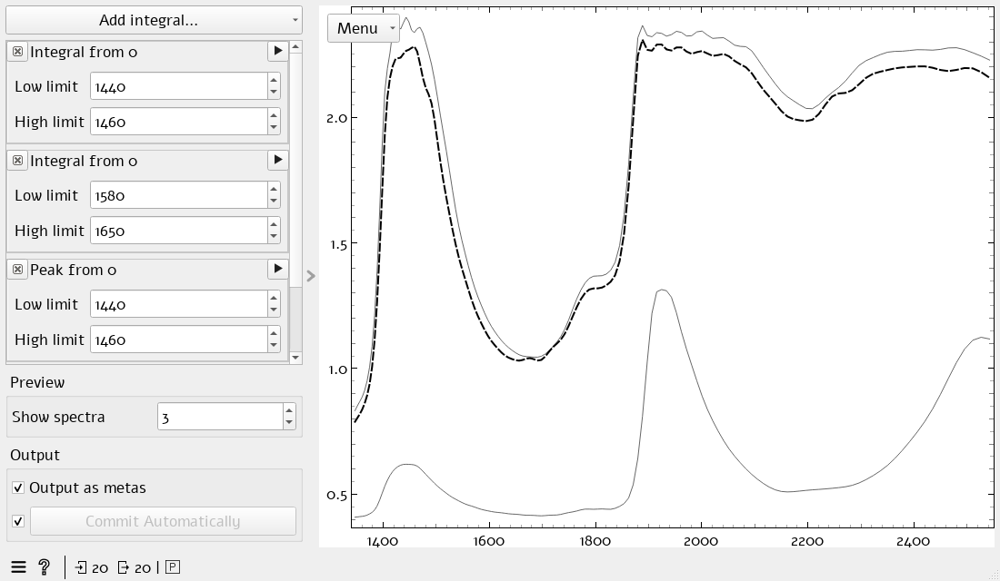
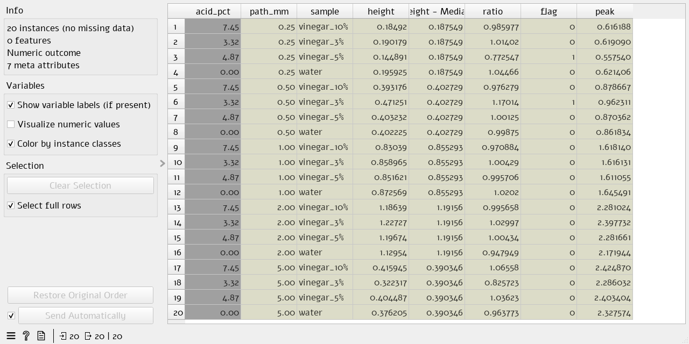
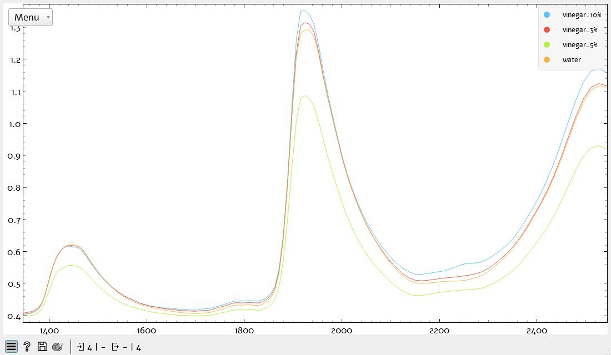
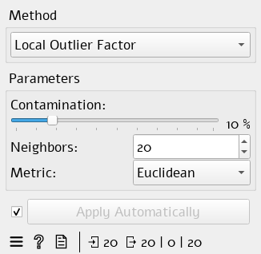
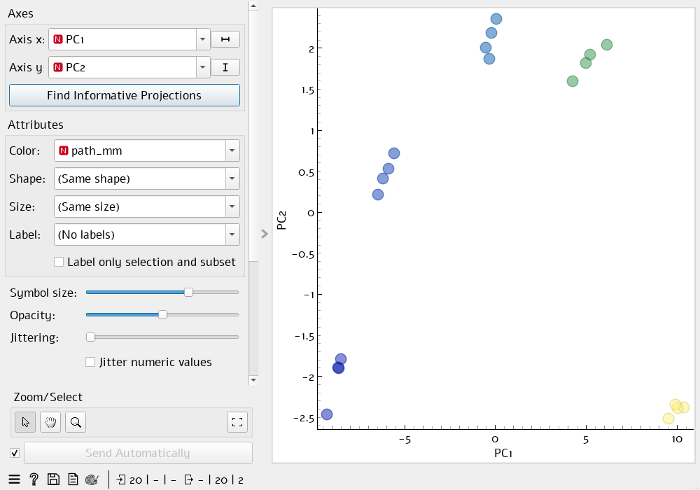

# 第 6 章 Orange 練習：資料品質與離群值

> 測試版本：**Orange 3.40.0** + **Spectroscopy 外掛 0.9.2**（Windows 11）。
> 工作流程檔：`exercises/orange/ch06_data_quality.ows`；資料：`data/spectra_wide_orange.csv`。
> 下文的 widget 名稱一律照 Orange 3.40.0 英文介面原文書寫，括號內是中文說明。
> 安裝 Orange 與 Spectroscopy 外掛的步驟見 [README](README.md)。

本章的設定都是**事先固定**的，不是看結果調出來的：

> 瓶名對照：`sample` 欄的 vinegar_3%、vinegar_5%、vinegar_10% 是標示酸度，Atago 酸度分別是 3.32 %、4.87 %、7.45 %（`acid_pct` 欄）。

- **A. 水帶高度檢查**：同一光徑的 4 瓶，水帶高度（1440–1460 nm 平均吸光度 − 1580–1650 nm 平均吸光度）除以這 4 瓶的中位數，超出 ±10 % 就是「可疑」。
- **B. 目視檢查**：把 0.25 mm 的 4 條光譜畫在一起，看可疑的那一條。
- **C. 自動偵測的陷阱**：把 20 條光譜（5 種光徑混在一起）丟給 **Outliers**（離群值），看它抓到什麼。

> **先講清楚三件事**
>
> 1. **Orange 的積分是梯形法，不是講義的「窗口平均」。** 兩者在本資料差別很小：0.25 mm 與 0.5 mm 的 8 個比值最多差 **0.0003**（4.87 % 瓶 0.7725 對講義 0.7723；3.32 % 瓶 1.1701 對講義 1.17），旗標結果完全一樣。細節見第 4 節。
> 2. **Orange 沒有 PCA 的 Q 殘差（重建誤差）。** 講義用「2 個主成分的 Q 殘差」排名；Orange 的 **PCA** 只給分數（PC1、PC2），沒有 widget 會算 Q。第 5 節用 PCA 散布圖看「光徑把光譜分群」，Q 排名請到 R / Python 練習。
> 3. **Outliers widget 在這份資料上不是「找壞光譜」的工具。** 它抓幾條由參數決定，不由資料品質決定（第 5 節實測）。

---

## 1. 開啟現成工作流程 ch06_data_quality.ows

1. **File → Open**，選 `exercises/orange/ch06_data_quality.ows`。
2. 畫布上有 20 個 widget，分成三條：

```
File ── Select Rows (replicate = 1)  [20 條]
   │
   ├─ A 水帶檢查
   │   Integrate Spectra ── Formula (water-band height) ─┬─ Select Columns (path, height) ── Group by path ──┐
   │                                                      └───────────────────────────────────────────────── Merge Data ◄┘ (Extra Data)
   │   Merge Data ── Formula (ratio, flag) ── Select Columns (summary) ─┬─ Data Table (ratios)
   │                                                                     ├─ Select Rows (flag = 1) ── Data Table (flagged)
   │                                                                     └─ Scatter Plot (ratio vs path)
   ├─ B 目視檢查
   │   Select Rows (0.25 mm) ── Formula (bottle label) ── Spectra (0.25 mm)
   └─ C 自動偵測
       Outliers ── Data Table (Outliers)
       PCA (20 raw spectra) ── Scatter Plot (PCA)
```

3. 雙擊 **Data Table (flagged)**：只有 2 列，**0.25 mm / vinegar_5%（ratio 0.7725）** 與 **0.5 mm / vinegar_3%（ratio 1.1701）**。
4. 雙擊 **Outliers**：預設方法 **Local Outlier Factor**，狀態列輸出 **20 | 0 | 20**（Inliers 20、Outliers **0**、Data 20）：預設值一條都沒抓到。

**關於資料路徑**：`.ows` 裡的 File 存的是**相對路徑**（`../../data/spectra_wide_orange.csv`）。保持
`（任意位置）/data/` 與 `（任意位置）/exercises/orange/` 的結構，整個資料夾搬到哪裡都能開（我們已把 `.ows` 與資料檔複製到別的資料夾重新載入驗證，數字相同）。如果 File widget 顯示紅色錯誤，雙擊它重新選檔即可。在 Orange 裡**另存**後路徑會變成你電腦上的絕對路徑；要發給別人請用原始的 `.ows`。

---

## 2. 從零自己拉一次

操作方式同前幾章：從左側面板拖 widget 到畫布，從右側弧形接口拖到另一個 widget 的左側接口連線，雙擊開設定視窗。

### 步驟 1　File → Select Rows：只留重複 1 的 20 條

- **File**：選 `data/spectra_wide_orange.csv`（21 instances、142 features）。
- **Select Rows**：`replicate` **equals** `1`，輸出 20 列。

> 資料集多一條重複：0.25 mm 的水量了兩次（`replicate` = 2）。本章所有數字都用重複 1。沒過濾的話，0.25 mm 會有 5 條光譜、中位數跟著變，比值全部對不上（見第 6 節陷阱 1）。

### A. 水帶高度檢查

#### 步驟 2　Integrate Spectra（積分光譜）：量兩個窗口

- 拖一個 **Integrate Spectra**（Spectroscopy 類別），從 Select Rows 的 **Matching Data** 連過來。
- 按 **Add integral…**，加三個積分（參數照下表，Low / High limit 直接輸入）：

| 順序 | 方法 | Low limit | High limit | 輸出欄位名稱 |
|---|---|---|---|---|
| 1 | **Integral from 0** | 1440 | 1460 | `1440.0 - 1460.0`（水帶面積） |
| 2 | **Integral from 0** | 1580 | 1650 | `1580.0 - 1650.0`（平坦區面積） |
| 3 | **Peak from 0** | 1440 | 1460 | `1440.0 - 1460.0 (1)`（水帶最高吸光度） |

- 勾 **Output as metas**（預設就是）與 **Commit Automatically**。輸出是原本的 20 條光譜加上這三個新欄位（放在 Metas）。



> 資料沒有剛好落在 1440、1460 的點：1440–1460 窗口內只有 4 個點（1443.165、1448.340、1453.552、1458.802，跨度 **15.637 nm**）；1580–1650 窗口內有 11 個點（1584.725 到 1649.442，跨度 **64.717 nm**）。Orange 的積分只用窗口內的點做梯形加總，所以「積分 ÷ 跨度」就是（近似的）窗口平均。

#### 步驟 3　Formula（公式）：算水帶高度與飽和檢查用的峰值

- 拖一個 **Formula**，從 Integrate Spectra 連過來。按 **New → Numeric** 新增欄位 `height`：

  `_1440_0___1460_0 / 15.637 - _1580_0___1650_0 / 64.717`

  這就是講義的定義：水帶平均 − 平坦區平均。
- 再新增 `peak`：

  `_1440_0___1460_0__1_`

  （水帶內最高的吸光度，下一節用來判斷有沒有飽和。）
- **變數名稱怎麼打**：Formula 會把欄位名稱裡的非字母數字全換成底線，開頭是數字再補一個底線，所以 `1440.0 - 1460.0` 變成 `_1440_0___1460_0`。不用背：在 **Select Feature** 下拉選單選欄位，Orange 會自動貼上正確的名稱。新欄位放在 Features 或 Metas 都可以（本檔案放 Metas）。

#### 步驟 4　Select Columns → Group by：每種光徑的中位數

- 拖 **Select Columns**，從 Formula 連過來。把 `path_mm`、`height` 放進 **Metas**，其他全部拿掉（Features 空、Target 空）。這一步只是讓 Group by 的清單乾淨。
- 拖 **Group by**（Transform 類別），從這個 Select Columns 連過來。左邊 **Group by** 選 `path_mm`；右邊表格點 `height` 那一列，**取消 Mean、勾 Median**；`path_mm` 那一列的聚合全部取消（它是分組欄位本身）。
- 輸出 5 列（5 種光徑），欄位 `height - Median` 是該光徑 4 瓶的中位數。

#### 步驟 5　Merge Data（合併資料）：把中位數貼回每一列

- 拖 **Merge Data**（Transform 類別）。**Data** 接步驟 3 的 **Formula**（20 列），**Extra Data** 接步驟 4 的 **Group by**。
- **Row matching** 預設是 `Row index`，**必須改**：左邊選 `path_mm`，右邊選 `path_mm`（matches）。Merging 維持預設（Append columns from Extra data）。
- 輸出仍是 20 列，多一欄 `height - Median`。

#### 步驟 6　Formula：比值與旗標

- 再拖一個 **Formula**，從 Merge Data 連過來，新增兩個欄位：

  | 名稱 | 運算式 |
  |---|---|
  | `ratio` | `height / height___Median` |
  | `flag` | `1 if (peak < 1.5 and abs(height / height___Median - 1) > 0.10) else 0` |

- `ratio` = 水帶高度 ÷ 該光徑的中位數。`flag` = 1 代表「可疑」，條件是**兩個都成立**：該光徑水帶沒飽和（`peak` < 1.5，第 1 章：A ≥ 1.5 的 1450 nm 水帶已經飽和），且比值偏離 1 超過 10 %。

#### 步驟 7　Select Columns → Data Table / Select Rows / Scatter Plot

- **Select Columns (summary)**：Target `acid_pct`，Metas 放 `path_mm`、`sample`、`height`、`height - Median`、`ratio`、`flag`、`peak`，Features 空（不然表格裡有 142 個波長欄位）。
- **Data Table (ratios)**：看 20 列。
- **Select Rows**：`flag` **equals** `1`，接 **Data Table (flagged)**。
- **Scatter Plot**：x = `path_mm`、y = `ratio`、Color = `flag`，可以看到每個光徑 4 個點的散布。



### B. 目視檢查：0.25 mm 的 4 條光譜

#### 步驟 8　Select Rows → Formula → Spectra

- **Select Rows**：從步驟 1 的 Select Rows 連過來，`path_mm` **equals** `0.25`，輸出 4 列。
- **Formula**：新增**類別型**欄位 `bottle`，運算式 `sample`（**Spectra** 只能用類別型變數上色，字串的 `sample` 不行；做法同第 1 章）。
- **Spectra**：左上 **Menu → Color by → bottle**。



四條線在 1450 nm 水帶附近（圖左邊那個小峰）平均吸光度是：vinegar_10%（Atago 7.45 %）0.6143、vinegar_3%（3.32 %）0.6181、**vinegar_5%（4.87 %）0.5558**、水 0.6198；**黃綠色那條（vinegar_5%）明顯低一截**。再看一下 1930 nm 的大峰：它只有 1.087，另外三條是 1.29–1.35；2500 nm 附近也低。也就是說這條光譜是整體偏低，不只水帶。

> 這就是「眼睛看得出來，但規則要事先定好」：我們先定 ±10 %，再看哪一瓶超出，而不是先看哪一條怪再回頭找理由。

### C. 自動偵測的陷阱

#### 步驟 9　Outliers（離群值）

- 拖 **Outliers**（Data 類別），從步驟 1 的 Select Rows 連過來（20 條光譜，**5 種光徑混在一起**）。
- **預設**：**Local Outlier Factor**、Contamination **10 %**、Neighbors **20**、Metric Euclidean。狀態列 **20 | 0 | 20**（Inliers | Outliers | Data）。
- 接 **Data Table (Outliers)**（接 Outliers 的 **Data** 輸出）：多一欄 `Outlier`（Yes / No）。預設全是 No。



- 換 **Method** 試試其他三種（參數保持預設），結果見第 5 節。

#### 步驟 10　PCA → Scatter Plot

- **PCA**：Components 2、**不要** Normalize variables，連到 **Scatter Plot**：x = PC1、y = PC2、Color = `path_mm`（同第 4 章分支 A）。



---

## 3. 預期結果：水帶高度比值

Orange（Integrate Spectra 的梯形積分）對講義（窗口平均，`site/nir-pathlength/lib/ch06data.js`）：

| 光徑 | 樣品 | 水帶峰值 | Orange 比值 | 講義比值 | 旗標 |
|---|---|---|---|---|---|
| 0.25 mm | 10 % | 0.616 | 0.9860 | 0.9862 | |
| 0.25 mm | 3.32 % | 0.619 | 1.0140 | 1.014 | |
| 0.25 mm | **4.87 %** | 0.558 | **0.7725** | **0.7723** | **可疑（−22.8 %）** |
| 0.25 mm | 水 | 0.621 | 1.0447 | 1.045 | |
| 0.5 mm | 10 % | 0.879 | 0.9763 | 0.9762 | |
| 0.5 mm | **3.32 %** | 0.962 | **1.1701** | **1.17** | **可疑（+17.0 %）** |
| 0.5 mm | 4.87 % | 0.870 | 1.0013 | 1.001 | |
| 0.5 mm | 水 | 0.862 | 0.9987 | 0.9988 | |
| 1 mm | 10 / 3.32 / 4.87 % / 水 | 1.61–1.65 | 0.9709 / 1.0043 / 0.9957 / 1.0202 | 0.9711 / 1.005 / 0.9952 / 1.02 | 水帶飽和，**不能用** |
| 2 mm | 同上 | 2.17–2.40 | 0.9957 / 1.0300 / 1.0043 / 0.9479 | 0.9968 / 1.032 / 1.003 / 0.9501 | 不能用 |
| 5 mm | 同上 | 2.29–2.43 | 1.0656 / 0.8257 / 1.0362 / 0.9638 | 1.062 / 0.8228 / 1.037 / 0.9633 | 不能用 |

- 旗標：0.25 mm 的 4.87 % 瓶（比值 0.7725，偏低 22.8 %；講義 0.7723）與 0.5 mm 的 3.32 %（1.1701，偏高 17 %）。其他 18 條都不旗標，完全對得上講義。
- 1 mm、2 mm、5 mm 的水帶峰值已超過 1.5（飽和，第 1 章），比值不能拿來判斷品質；表中的數字只是列出來讓你看見：**5 mm 的 3.32 % 比值 0.8257，如果沒有「峰值 < 1.5」這條規則，會被誤旗標**（驗證腳本確認，這是唯一一個）。

**數字怎麼驗證的**：用 Orange 3.40.0 自己的 scheme API 建立 `.ows`；再以 headless 方式（`QT_QPA_PLATFORM=offscreen`）重新載入，讓訊號流完後直接讀 **Data Table (ratios)**，與 numpy 直接照講義定義（窗口平均）重算的比值，以及 `ch06data.js` 的數字比對。腳本：`exercises/orange/tools/build_ch06_ows.py`、`verify_ch06_ows.py`。

---

## 4. 為什麼 Orange 的比值跟講義差一點點

- 講義：窗口平均 = 窗口內各點吸光度直接平均。
- Orange（**Integral from 0**）：窗口內各點吸光度做**梯形積分**，再除以窗口跨度（15.637 或 64.717 nm）。兩者的差別來自權重：梯形積分給窗口兩端的點半個權重，窗口內各點的間距也不完全相等。
- 實際差異：水帶高度整體偏高約 0.0003–0.0005（例如 0.25 mm 的水：Orange 0.1959，講義 0.1955），但同一光徑的 4 瓶偏高量幾乎一樣，除以中位數之後大部分抵消。0.25 / 0.5 mm 的 8 個比值與講義最多差 **0.0003**；飽和的 2 mm、5 mm 最多差 0.0036，反正本來就不能用。
- 要「完全相同」只能在 **Formula** 裡逐欄手動把 4 個點、11 個點平均，運算式又長又難教，所以不這樣做。這個誤差遠小於 ±10 % 的判斷門檻，不影響結論。
- 中位數：**Group by** 的 Median 與講義的 `np.median` 相同（4 個值取中間兩個的平均）。

---

## 5. 自動偵測：Outliers widget 實測

資料：20 條**原始**光譜（重複 1，5 種光徑混在一起），預設參數，只換 Method。講義（R / Python）用 PCA 的 Q 殘差排名，前 4 名是 **2 mm 水、2 mm 3.32 %、0.25 mm 4.87 %、2 mm 4.87 %**，0.5 mm 3.32 % 排第 8；排在前面的多是 **2 mm（飽和）**，不是品質出問題。

| Method（預設參數） | 抓到幾條 | 哪幾條 |
|---|---|---|
| **Local Outlier Factor**（預設；Contamination 10 %、Neighbors 20） | **0** | 無 |
| One Class SVM（nu 50 %、gamma 0.01） | **10**（正好一半） | 0.25 mm 4.87 %、0.25 mm 水、0.5 mm 10 %、1 mm 10 %、2 mm 10 %、2 mm 3.32 %、5 mm 10 %、3.32 %、4.87 %、水 |
| Covariance Estimator（Contamination 10 %） | **2**（20 的 10 %） | 0.25 mm 水、0.5 mm 10 % |
| Isolation Forest（Contamination 10 %） | **2**（20 的 10 %） | 0.25 mm 4.87 % 加上 5 mm 10 %（有時是 2 mm 3.32 %） |

我們從這張表讀出：

1. **預設值（LOF）一條都沒抓到**，連講義裡 −22.8 % 的那瓶也沒有。換成別的方法才有東西出來，但：
2. **抓幾條是參數決定的，不是資料決定的**：One Class SVM 的 nu = 50 % 就是 20 條裡抓 10 條；Covariance Estimator 與 Isolation Forest 的 Contamination = 10 % 就是 20 條裡抓 2 條，資料再乾淨也是這樣。
3. **Covariance Estimator 的結果其實是平手後的隨機結果**：它輸出的 `Mahalanobis` 欄，20 條全部是 **18.8544**（20 條樣品、142 個波長，波長比樣品多，共變異矩陣是奇異的，每一條的距離都一樣）。所以「抓 0.25 mm 水和 0.5 mm 10 %」沒有任何意義。
4. **Isolation Forest 每次重跑不一定一樣**（Replicable training 沒勾）：0.25 mm 4.87 % 我們看到的每一次都在，第二條多半是 5 mm 10 %，有幾次是 2 mm 3.32 %。要固定結果請勾 **Replicable training**。
5. **沒有任何一種方法抓到 0.5 mm 的 3.32 % 瓶**（水帶高 +17 %）。
6. 抓到的條目大量是 **5 mm、2 mm、1 mm**，也就是「光徑長（飽和）」造成的差異：One Class SVM 把 5 mm 的 4 條**全部**抓出來。

**PCA 散布圖**（步驟 10）說明為什麼：PC1 解釋 **91.7 %** 的變異（PC2 6.9 %），20 個點依光徑排成 5 群（PC1 由左到右：0.25 mm 約 −8.5 到 −9.3、0.5 mm 約 −6、1 mm 約 0、2 mm 約 4 到 6、5 mm 約 10）。把光徑不同的光譜放在一起，離群偵測在比的是光徑與飽和，不是品質：**要跟同光徑的光譜比**（水帶檢查就是這樣：只在同一光徑的 4 瓶之間比）。

> **Q 殘差**（講義的排名依據）Orange 沒有 widget 算。驗證腳本用 numpy 重算（2 個主成分、mean-center、不縮放）：前 8 名是 2 mm 水（Q = 1.440）、2 mm 3.32 %（1.332）、0.25 mm 4.87 %（1.296）、2 mm 4.87 %（1.273）、0.5 mm 10 %（1.244）、2 mm 10 %（1.201）、0.5 mm 4.87 %（0.952）、0.5 mm 3.32 %（0.828），與講義的名次完全一致（4.87 % 瓶第 3、3.32 %/0.5 mm 瓶第 8）。要在 R / Python 看這個排名，請做 `exercises/ch06_data_quality.R` 或 `.ipynb`。

---

## 6. 常見陷阱

1. **忘了先過濾 `replicate` = 1**：0.25 mm 會多出第 5 條（水的第二次測量），該光徑中位數從 0.1875 變成 0.1902，比值全部變了（4.87 % 瓶 0.7619、水 1.0302 與 1.0362）。4.87 % 瓶仍被旗標，但數字跟講義對不上。
2. **對飽和光徑也套用比值規則**：1、2、5 mm 水帶峰值 ≥ 1.5，比值只是在量「飽和得有多平」。沒加 `peak < 1.5` 會把 5 mm 的 3.32 % 瓶（0.8257）誤旗標。
3. **Group by 沒改成 Median**：預設是 Mean。平均值受那瓶可疑的值拉扯（0.25 mm：平均 0.1790，中位數 0.1875），比值會被扭曲；講義用中位數就是為了這個。
4. **Merge Data 的 Row matching 沒改**：預設是 Row index，只有前 5 列會拿到 Group by 的值（依列號對，不是依光徑），其餘 15 列是空的。一定要設成 `path_mm` ↔ `path_mm`。
5. **Formula 裡的欄位名稱**：`1440.0 - 1460.0` 在運算式裡是 `_1440_0___1460_0`；`height - Median` 是 `height___Median`。用 **Select Feature** 選單貼最保險。
6. **Spectra 不能用字串（`sample`）或數值（`path_mm`）上色**：要先用 Formula 做類別型欄位。
7. **Outliers 的結果不要當結論**：見第 5 節。抓不抓得到、抓幾條由參數決定；同光徑比較才有意義。
8. **Preprocess 類 widget 的自動送出**：本章 Integrate Spectra 預設勾 **Commit Automatically**；如果自己重新拉時沒勾，記得按 **Commit**。

---

## 7. 與 R / Python 練習的對照

| 步驟 | Orange widget | R / Python（`exercises/ch06_data_quality.R`、`.ipynb`） |
|---|---|---|
| 水帶高度 | **Integrate Spectra**（梯形積分）→ **Formula**，與講義最多差 0.0003 | 窗口內直接平均 |
| 同光徑中位數與比值 | **Group by**（Median）→ **Merge Data** → **Formula** | `median`、除法 |
| ±10 % 旗標與飽和規則 | **Formula** 的 `flag` | 事先固定的規則 |
| 0.25 mm 四條光譜 | **Select Rows** → **Spectra** | `matplot` / matplotlib |
| 自動偵測 | **Outliers**（四種方法，預設 0 條） | PCA（2 成分）Q 殘差排名 |
| 把光徑混在一起的陷阱 | **PCA** 散布圖（看得到分群，沒有 Q） | Q 排名：前面多是 2 mm（飽和） |

本章 Orange 做得到的是「水帶比值檢查」與「看出自動偵測的問題」；Q 殘差與後續的「把可疑光譜修正或刪掉，分數會怎樣」都在 R / Python 練習，Orange 部分做完後請接著做那邊。
