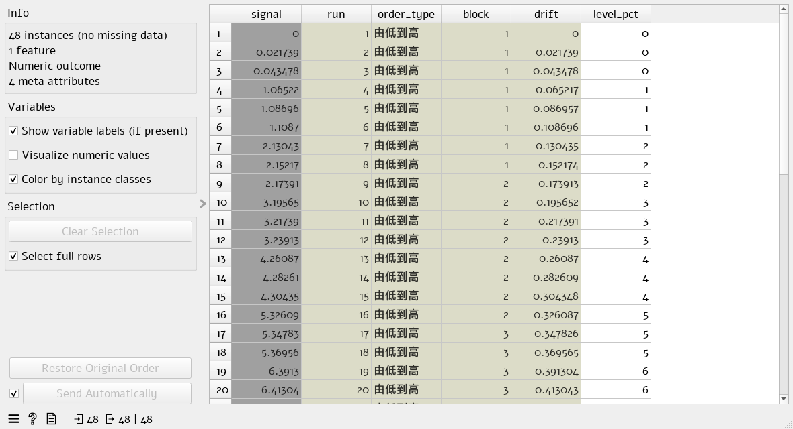
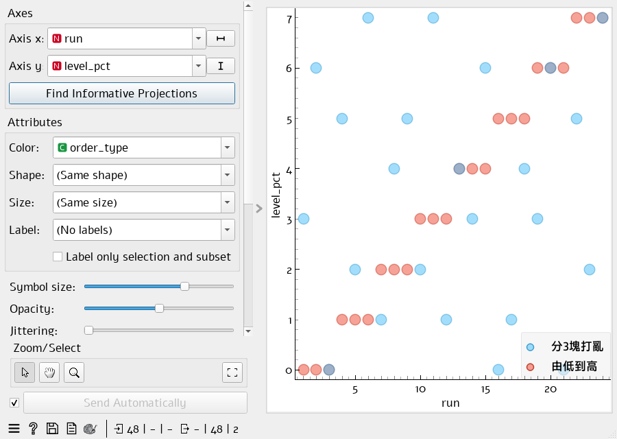
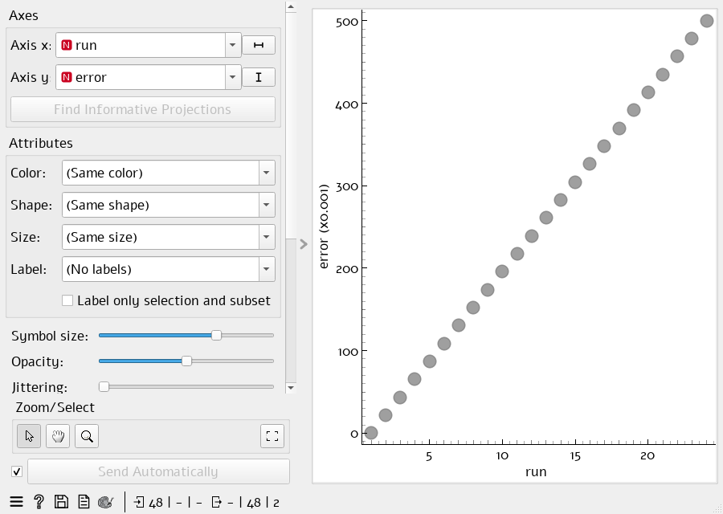
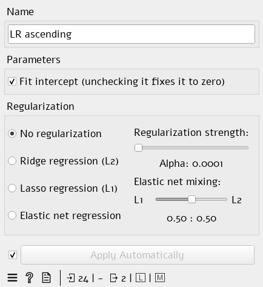
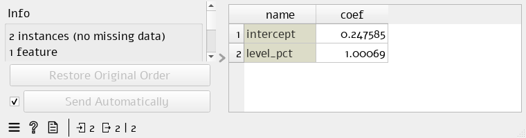

# 第 7 章 Orange 練習：測量順序會偷走斜率

> 測試版本：**Orange 3.40.0**（本章**不需要** Spectroscopy 外掛）。
> 工作流程檔：`exercises/orange/ch07_design.ows`；資料：`exercises/orange/ch07_design.csv`（由 `exercises/orange/tools/make_ch07_design.py` 產生）。
> 下文的 widget 名稱一律照 Orange 3.40.0 英文介面原文書寫，括號內是中文說明。
> 安裝 Orange 的步驟見 [README](README.md)。

本章要回答講義「設計下一次實驗」裡的一個問題：**同樣 24 次測量、同樣 8 個濃度各 3 次，只改變測量的先後順序，斜率會差多少？**

> **先講清楚三件事**
>
> 1. **漂移是「示意」，不是實測。** 資料表裡的 `signal` = 真實濃度 `level_pct` + 漂移，漂移 = 0.5 × (run − 1) / 23：假設儀器訊號隨時間線性往上爬，整段 24 次測量共爬 0.5（相當於 0.5 % 濃度）。這是為了讓效果看得見而設定的數字（與講義 `tools/nir-pathlength/make_data_ch07.py` 的設定相同），沒有任何一個數字來自真的光譜。
> 2. **沒有亂數、沒有種子。** 「分 3 塊打亂」用的是講義裡那一組固定的順序（每塊 8 個濃度各 1 次、3 塊的排法不同），任何人重做都得到同樣的數字。
> 3. **Orange 只能算「這一組順序」的斜率，不能算「所有可能順序」的分布。** 完全隨機、分塊隨機的斜率偏差標準差，以及預試驗標準差的信賴區間、Fieller 區間的寬度，都要到 R / Python（第 5 節）。

---

## 1. 開啟現成工作流程 ch07_design.ows

1. **File → Open**，選 `exercises/orange/ch07_design.ows`。
2. 畫布上有 11 個 widget：

```
File (ch07_design.csv, 48 列)
   ├─ Data Table (design)
   ├─ Scatter Plot (run vs level)               看順序和濃度的關係
   ├─ Formula (error) ── Scatter Plot (run vs error)   看漂移
   ├─ Select Rows (ascending) ── Linear Regression (ascending) ── Data Table (slope, ascending)
   └─ Select Rows (blocked)   ── Linear Regression (blocked)   ── Data Table (slope, blocked)
```

3. 雙擊兩個 **Data Table (slope, …)**，直接讀斜率（`level_pct` 那一列的 `coef`）：

| 測量順序 | 斜率（`level_pct` 的 coef） | 截距 | 與真值 1 的差 |
|---|---|---|---|
| 由低到高 | **1.06522** | 0.0217 | **+6.5 %** |
| 分 3 塊打亂 | **1.00069** | 0.2476 | +0.07 % |

資料路徑：`.ows` 裡的 File 存**相對路徑**（`ch07_design.csv`，與 `.ows` 同一個資料夾）。把 `ch07_design.ows` 和 `ch07_design.csv` 放在同一個資料夾就能開；如果 File widget 顯示紅色錯誤，雙擊它重新選檔即可。

---

## 2. 資料表長什麼樣

雙擊 **Data Table (design)**：48 列，是兩種順序疊在一起（各 24 次）。

| 欄位 | 意義 |
|---|---|
| `run` | 第幾次測量（1–24），也就是時間 |
| `level_pct` | 真實濃度 0–7 %，每個濃度測 3 次 |
| `order_type` | `由低到高`（0,0,0,1,1,1,…,7,7,7）或 `分3塊打亂`（3 塊，每塊 8 個濃度各 1 次） |
| `signal` | 測得的訊號 = `level_pct` + 漂移（目標變數） |
| `block` | 時間區塊：run 1–8 為 1、9–16 為 2、17–24 為 3 |
| `drift` | 示意的漂移 = 0.5 × (run − 1) / 23（只是讓你看見，迴歸不用它） |



> 讀入時 `signal` 是 Target（藍灰底）、`level_pct` 是唯一的 Feature、其他是 Metas。這是 CSV 標題列裡的旗標（`cC#signal`、`C#level_pct`、`mC#…`）決定的，不用自己設。

---

## 3. 從零自己拉一次

操作方式同前幾章：從左側面板拖 widget 到畫布，從右側弧形接口拖到另一個 widget 的左側接口連線，雙擊開設定視窗。

### 步驟 1　File

- **File**：選 `exercises/orange/ch07_design.csv`（48 instances、1 feature、Numeric outcome）。

> 如果 `order_type` 的中文變成亂碼：這個 CSV 已經存成帶 BOM 的 UTF-8；用別的編輯器改存時請選 **UTF-8 with BOM**，或在 File widget 的 **Encoding** 手動選 UTF-8。

### 步驟 2　Scatter Plot：順序和濃度糾纏在一起

- 拖 **Scatter Plot**，從 File 連過來。**Axis x** = `run`、**Axis y** = `level_pct`、**Color** = `order_type`。



我們從圖上讀出：

- **紅點（由低到高）**排成一條階梯：run 越大濃度越高，`run` 與 `level_pct` 的相關係數是 **0.993**（驗證腳本算的）。時間和濃度幾乎是同一件事。
- **藍點（分 3 塊打亂）**散在整張圖，相關係數只有 **0.011**：每個時段裡高低濃度都有。
- 灰色的點是紅藍兩點剛好疊在一起（run 3、13、20、24）。

### 步驟 3　Formula → Scatter Plot：漂移長什麼樣

- 拖 **Formula**，從 File 連過來，按 **New → Numeric** 新增 `error`，運算式 `signal - level_pct`（訊號減真值，只剩漂移）。
- 再拖一個 **Scatter Plot**，x = `run`、y = `error`。



- 這是一條直線，從 0 爬到 0.5（圖軸單位是 ×0.001，所以頂端標 500）。**兩種順序的點完全重疊**：漂移只跟「幾點測」有關，跟「測哪個濃度」無關。差別只在於漂移**落在哪些濃度身上**。

### 步驟 4　Select Rows：分開兩種順序

- 拖兩個 **Select Rows**，都從 File 連過來。
  - 第一個：`order_type` **is** `由低到高`（輸出 24 列）。
  - 第二個：`order_type` **is** `分3塊打亂`（輸出 24 列）。
- 兩個都接 **Matching Data**。

### 步驟 5　Linear Regression → Coefficients → Data Table

- 各拖一個 **Linear Regression**（Model 類別），從各自的 Select Rows 的 **Matching Data** 連過來。設定：**No regularization**、**Fit intercept** 打勾。
- 各拖一個 **Data Table**，從 Linear Regression 的 **Coefficients** 連過來。



- 擬合的是 `signal = a + b × level_pct`，所以 `b` 就是「訊號對濃度的斜率」；沒有漂移時 `b` 應該剛好是 1。




---

## 4. 我們從結果讀出什麼

1. **由低到高的斜率是 1.06522，比真值 1 大 6.5 %。** 漂移其實跟濃度完全無關，但是因為順序和濃度糾纏（相關 0.993），迴歸把「晚測的訊號都偏高」當成「高濃度的訊號比較高」，漂移就變成斜率的一部分。這個偏差**不會因為多測幾次而變小**：每個濃度都測 3 次，偏差還是 6.5 %。
2. **分 3 塊打亂的斜率是 1.00069，只差 0.07 %。** 每一塊裡 8 個濃度各 1 次，塊與塊之間的漂移（第 2 塊比第 1 塊高、第 3 塊更高）對 8 個濃度是一樣的，被抵銷；只剩塊內的小漂移。
3. **0.07 % 是「這一組順序」的數字，不是保證。** 另一種塊內排法會是別的小數字；講義用公式給出分塊隨機的偏差標準差約 0.47 %（95 % 約 ±0.93 %）、完全隨機約 1.37 %（95 % 約 ±2.7 %）。Orange 沒有 widget 做這種「所有排法的分布」。
4. **這是「示意」。** 真實儀器的漂移不一定線性、也不一定這麼大。要點是：**順序和濃度糾纏的設計，會把你控制不了的漂移算進你要估計的斜率**；而且 `Linear Regression` 的結果看起來完全正常，R² 很高，Orange 不會警告你。

---

## 5. 常見陷阱

1. **忘了用 Select Rows 分開兩種順序**：48 列一起丟進 Linear Regression，得到的是兩種設計混在一起的斜率（約 1.03），沒有意義。
2. **Select Rows 選錯值**：`order_type` 是類別型欄位，下拉選單裡是兩個值；選錯就會把兩個設計的結果對調。看 Linear Regression 左下角的輸入列數是否都是 24。
3. **Linear Regression 的 Regularization 沒選 No regularization**：Ridge / Lasso 會把斜率壓小，數字就對不上 1.06522。
4. **把 `drift` 欄當特徵**：它只是給你看的 Meta，不要放進 Features；放進去等於「已知漂移」，這在真實實驗裡做不到。

---

## 6. Orange 做不到的部分，請到 R / Python

| 想做的事 | Orange | R / Python（`exercises/ch07_experiment_design.R`、`.ipynb`；執行順序表 `exercises/ch07_run_sheet.csv`） |
|---|---|---|
| 兩種固定順序的斜率偏差 | **Linear Regression** → Coefficients（本章） | 同上，並改變漂移大小 |
| 所有隨機排列、分塊隨機排列的偏差分布 | 沒有 | 公式與模擬 |
| 預試驗標準差的信賴區間（要重複幾次才夠） | 沒有 | 卡方區間 |
| 區間（Fieller）寬度怎麼隨誤差變 | 沒有（Orange 只有點預測，第 5 章已提過） | 公式；把 24 次填樣當獨立點得 ±0.51 %，只在配製誤差為 0 時成立；改分析 8 個濃度平均（自由度 6）則 ±0.60 %（配製誤差 0）、±0.71 %（配製誤差 0.4 %，填樣誤差 0.4 %、未知樣品填 3 次），兩種情況都有效 |
| 濃度怎麼排（兩端 / 三點 / 八點）與缺適性檢定 | 可以手動重複本章步驟，但沒有檢定 | 斜率標準誤與檢定 |
| 產生可帶到實驗室的執行順序表 | 沒有 | `ch07_run_sheet.csv`（14 欄、49 列：預試驗 13 + 主實驗 24 + 驗證 12；欄位：階段、區塊、樣品、順序、濃度_pct、第幾次填樣、第幾次掃描，加上 7 個手填欄）；紀錄表見 `ch07_record_sheet.md` |

本章 Orange 做得到的是「**看見**順序把漂移變成斜率」；下一次實驗該怎麼排、要預試驗幾次，請接著做 R / Python 練習。
