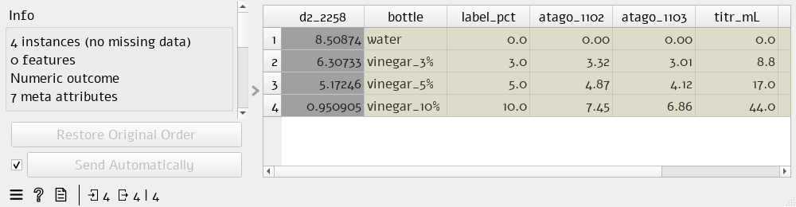
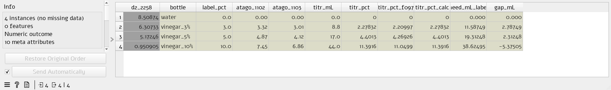
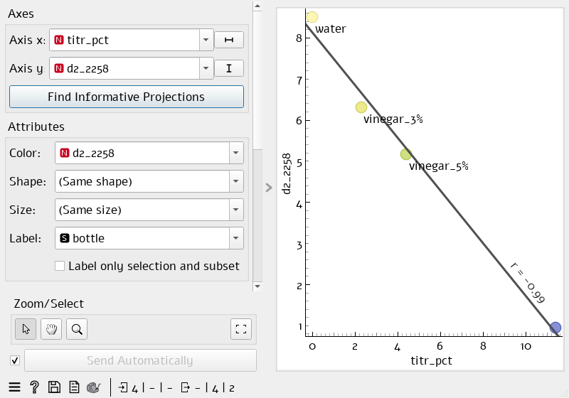
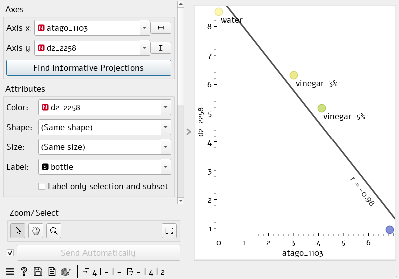
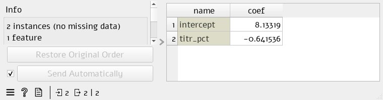
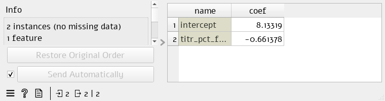
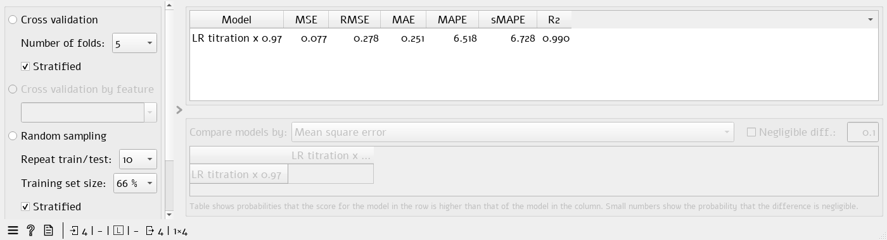

# 第 8 章 Orange 練習：參考方法的誤差

> 測試版本：**Orange 3.40.0**（本章**不需要** Spectroscopy 外掛）。
> 工作流程檔：`exercises/orange/ch08_references.ows`；資料：`exercises/orange/ch08_references.csv`（由 `exercises/orange/tools/make_ch08_references.py` 產生）。
> 下文的 widget 名稱一律照 Orange 3.40.0 英文介面原文書寫，括號內是中文說明。
> 安裝 Orange 的步驟見 [README](README.md)。

校正線的「真值」其實是別的方法量出來的數字，它們自己就有誤差。本章用 Orange 回答三個問題：

1. 標示、Atago、滴定三組參考值差多少？**換成滴定管的毫升數**來看，差距有多大？
2. 這個差距和讀數的不確定度（約 0.05 mL）比起來是大還是小？
3. 如果滴定用的 NaOH 力價整批偏了 3 %，校正線的斜率和 R² 會怎樣？

> **先講清楚幾件事**
>
> 1. **Atago 讀值來自 ATAGO PAL-Easy ACID，它是導電度式的酸度計，不是折射計。** 弱酸（醋酸）的導電度不跟濃度成正比，所以 Atago 讀值跟滴定的比值會隨濃度改變（第 2 章已看過：0.757 / 1.068 / 1.661）。
> 2. **滴定也只做了一次。** 一次滴定的結果出錯，從數字上看不出來。三個參考值彼此不一致，**不等於**哪一個「錯了」；只能說「值得重測」。
> 3. **「−3 %」是示意，不是實測。** `titr_pct_f097` = 滴定酸度 × 0.97，只是要看「整批偏 3 %」會怎樣；NaOH 實際偏多少，要用 KHP 標定才知道。
> 4. **Orange 只能做點估計與擬合，不能做不確定度預算、也不能算預測的 Fieller 區間。** 這兩件事請到 R / Python（第 6 節）。

---

## 1. 開啟現成工作流程 ch08_references.ows

1. **File → Open**，選 `exercises/orange/ch08_references.ows`。
2. 畫布上有 17 個 widget：

```
File (ch08_references.csv, 4 列)
   ├─ Data Table (references)
   ├─ Formula (titration, gap) ─┬─ Data Table (gap in mL)
   │                            ├─ Scatter Plot (d2 vs label)
   │                            ├─ Scatter Plot (d2 vs Atago 11-02)
   │                            ├─ Scatter Plot (d2 vs Atago 11-03)
   │                            └─ Scatter Plot (d2 vs titration)
   ├─ Select Columns (titration)        ── Linear Regression (titration)
   │       ├─ Coefficients ── Data Table (slope, titration)      └─ Test and Score (titration)
   └─ Select Columns (titration x 0.97) ── Linear Regression (titration x 0.97)
           ├─ Coefficients ── Data Table (slope, titration x 0.97)  └─ Test and Score (titration x 0.97)
```

3. 看 **Data Table (slope, …)**（兩個斜率）與 **Test and Score**（兩個 R2），與第 4 節預期值對照。

**關於資料路徑**：`.ows` 裡的 File 存**相對路徑**（`ch08_references.csv`，與 `.ows` 同一個資料夾）。把 `ch08_references.ows` 和 `ch08_references.csv` 放在同一個資料夾就能開；File widget 顯示紅色錯誤時，雙擊它重新選檔。

---

## 2. 資料表長什麼樣

雙擊 **Data Table (references)**：4 列（水＋3 瓶醋）。

| 欄位 | 角色 | 意義 |
|---|---|---|
| `bottle` | meta（文字） | water、vinegar_3%、vinegar_5%、vinegar_10% |
| `label_pct` | meta | 瓶身標示 0 / 3 / 5 / 10 % |
| `atago_1102`、`atago_1103` | meta | Atago PAL-Easy ACID 兩天的讀值（11/02、11/03）；水 = 0 |
| `titr_mL` | meta | 滴定用掉的 0.1 N NaOH（mL）：0 / 8.8 / 17 / 44 |
| `titr_pct` | meta | 滴定酸度 = `titr_mL` × 0.2589（由產生器寫入） |
| `d2_2258` | **target** | 1 mm、第 1 次重複、SG（9 點、二次）二階導數 × 10³ 在 2258 nm 的值 |
| `titr_pct_f097` | meta | `titr_pct` × 0.97（示意：NaOH 力價整批偏 −3 % 的校正） |

> 資料是確定性的（沒有亂數）：`d2_2258` 由 `data/spectra_long.csv` 重算，與講義 `site/nir-pathlength/lib/ch08data.js` 用的是同一筆。CSV 已存成帶 BOM 的 UTF-8；用別的編輯器改存時請選 **UTF-8 with BOM**。



---

## 3. 從零自己拉一次

### 步驟 1　File（讀檔）

- **File** 選 `exercises/orange/ch08_references.csv`：4 instances、Numeric outcome（`d2_2258`）、其餘 7 欄是 meta。

### 步驟 2　Formula（公式）：看見滴定公式，並把差距換成毫升

滴定酸度的公式：**酸度 (w/v %) = V × f × 0.006 × (100 / 25) × (100 / 10)**。
其中 f = 1.07875（NaOH 力價，由稱重配製、**沒有標定**），0.006 g/mL 是 0.1 N 醋酸的當量，(100/25) 是取 25 mL 滴定，(100/10) 是 10 mL 醋稀釋到 100 mL。把常數乘起來：f × 0.006 × 4 × 10 = **0.2589**，所以

> 酸度 (%) = 0.2589 × V（mL）

- 拖一個 **Formula**，從 File 連過來。按 **New → Numeric** 新增三個欄位，都勾選 **Meta attribute**：

| 名稱 | 運算式 | 意義 |
|---|---|---|
| `titr_pct_calc` | `0.2589 * titr_mL` | 滴定酸度，應等於 CSV 的 `titr_pct` |
| `need_mL_label` | `label_pct / 0.2589` | **如果瓶子的標示是對的，應該要滴多少 mL** |
| `gap_mL` | `label_pct / 0.2589 - titr_mL` | 標示對應的體積 − 實際滴定體積（正 = 滴得比標示少） |

- 同一個 Formula 裡的新欄位**只能引用輸入資料已有的欄位**，不能引用剛定義的欄位，所以 `gap_mL` 寫成完整式子。
- 接一個 **Data Table (gap in mL)** 讀結果。



### 步驟 3　Scatter Plot（散佈圖）：NIR 訊號對每一種參考值

- 拖四個 **Scatter Plot**，都從 Formula 連過來。**Axis y** 一律 `d2_2258`，**Axis x** 分別是 `label_pct`、`atago_1102`、`atago_1103`、`titr_pct`，**Label** = `bottle`，勾選 **Show regression line**。





- 4 個點大致在一條向下的直線上（二階導數的吸收峰是負向，所以濃度越高值越小）。

### 步驟 4　Select Columns → Linear Regression → Coefficients（比例誤差示範）

- 拖兩個 **Select Columns**，都從 File 連過來。
  - 第一個：Features = `titr_pct`，Target = `d2_2258`，Metas 清空。
  - 第二個：Features = `titr_pct_f097`，Target = `d2_2258`，Metas 清空。
- 各接一個 **Linear Regression**（**No regularization**、**Fit intercept** 打勾），再把 **Coefficients** 接到 **Data Table**。
- 各接一個 **Test and Score**（Data 接 Select Columns、Learner 接 Linear Regression），左側選 **Test on train data**，讀 **R2**。







---

## 4. 我們從結果讀出什麼

### 4.1 差距換成毫升

雙擊 **Data Table (gap in mL)**（以標示為準）：

| 瓶 | 標示 % | 標示對應 `need_mL_label` | 實際滴定 `titr_mL` | `gap_mL` |
|---|---|---|---|---|
| 第 1 瓶（3 %） | 3 | 11.587 | 8.8 | **+2.787** |
| 第 2 瓶（5 %） | 5 | 19.312 | 17.0 | **+2.312** |
| 第 3 瓶（10 %） | 10 | 38.625 | 44.0 | **−5.375** |

- 一次滴定讀數的標準不確定度（兩次滴定管讀數＋器材允差＋終點多一滴）約 **0.05 mL**（講義 `site/nir-pathlength/lib/ch08data.js`，`CH8.budget.uV` = 0.0497 mL）。
- 標示與滴定的差是 2–5 mL，約是讀數不確定度的 **50–100 倍**。所以這個差**不可能只是滴定管讀數的雜訊**；原因在別處：標示值本身（廠商只標「約 x %」）、Atago 的非線性、稀釋與取樣、NaOH 力價沒標定，或這一次滴定操作有誤。
- 想知道三個參考值各差多少，把 `label_pct` 換成 `atago_1103`（Formula 裡的運算式改成 `atago_1103 / 0.2589 - titr_mL`）：3 瓶分別是 +2.83、−1.09、−17.50 mL；換成 `atago_1102` 是 +4.02、+1.81、−15.22 mL。10 % 瓶差最多，因為 Atago 在高濃度讀得偏低（導電度不跟濃度成正比）。

### 4.2 第 1 瓶（標示 3 %）最可疑，但不是「證明錯了」

第 1 瓶滴定只有 2.278 %，比標示（3）和兩天的 Atago（3.32、3.01）都低。三個方法裡只有滴定是**只做一次**的。我們只能說：

- 這一筆**優先重測**（先用 KHP 標定 NaOH、做空白、三重複），而不是直接刪掉，也不是因為「滴定最準」就相信它。
- 沒有重複就無法分辨是醋本身、還是這次操作出錯。

### 4.3 比例誤差：斜率變了，擬合品質沒變

| 參考值 | 斜率（`d2_2258` 對參考值） | 截距 | R2（Test on train data） |
|---|---|---|---|
| `titr_pct` | **−0.64154** | 8.13319 | **0.990**（0.98980） |
| `titr_pct_f097`（× 0.97） | **−0.66138** | 8.13319 | **0.990**（0.98980） |

- 與講義 `CH8.factor` 一致：斜率 −0.6415 與 −0.6614，R² 都是 0.9898。
- 斜率的比值 = 0.66138 / 0.64154 = **1.0310 ≈ 1/0.97**（1.0309）：參考值全部乘 0.97，斜率就整個除以 0.97；截距不變；**R² 完全不變**。
- 這說明：**R² 高不代表參考值準。** 力價偏 3 % 這一類「比例誤差」不會讓校正線變難看，卻會讓所有預測值同比例偏（講義：y0 = 4.20 時預測 6.131 vs 5.947，差 3 %）。要抓出它，需要用獨立的標準物（KHP 標定）檢查，不能靠 R²。
- 注意：Orange 的 Linear Regression 擬合 `d2_2258 = a + b × 參考值`，與講義的「訊號對濃度」方向相同，所以這裡的斜率與講義**直接相同**（不像第 1–5 章要反向校正）。

---

## 5. 常見陷阱

1. **Formula 裡引用剛定義的欄位**：`gap_mL` 不能寫成 `need_mL_label - titr_mL`（會找不到變數）；要寫完整式子。
2. **Select Columns 沒清空 Metas 或選錯 Features**：Linear Regression 只該有一個特徵（`titr_pct` 或 `titr_pct_f097`）；Features 多放了參考值，R² 是兩個特徵的，斜率對不上 −0.64154。
3. **Linear Regression 的 Regularization 沒選 No regularization**：Ridge / Lasso 會把斜率壓小。
4. **把比值看成力價問題**：Atago ÷ 滴定的比值若只是 NaOH 力價錯，3 瓶會乘同一個數；實際從 0.76 爬到 1.66，所以主要不是力價問題（見第 2 章）。
5. **在 4 個點上讀太多**：只有 4 點（自由度 2）。R² 0.990 看起來很漂亮，區間卻很寬（見下一節）。

---

## 6. Orange 做不到的部分，請到 R / Python

| 想做的事 | Orange | R / Python（`exercises/ch08_reference_methods.R`、`.ipynb`） |
|---|---|---|
| 把差距換成毫升、看比例誤差如何改斜率 | **Formula**、**Linear Regression**（本章） | 同上 |
| 滴定的**不確定度預算**（滴定管、終點、10 mL 移液管、100 mL 容量瓶、25 mL 移液管各占多少，合成標準不確定度） | 沒有 | 有（器材允差 ÷ √3 後以平方和合成） |
| 預測值的 **Fieller 區間**（只有 3 點線時自由度只有 1，區間可能非常寬） | 沒有（Orange 只有點預測，第 5 章已提過） | 有 |
| 三重複滴定平均後不確定度降為 1/√3 | 沒有 | 有 |
| 實驗室紀錄與標準作業 | 沒有 | 滴定紀錄表 `exercises/ch08_titration_sheet.csv`；滴定 SOP `exercises/ch08_titration_sop.md` |

本章 Orange 做得到的是「**看見**參考值的差距有多大、比例誤差如何改變斜率而不改變 R²」；參考值的不確定度要怎麼估、預測區間多寬，請接著做 R / Python 練習，並用紀錄表把第 1 瓶重測一次。
