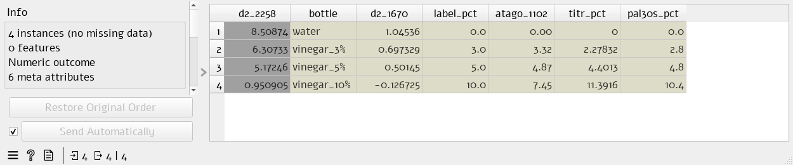
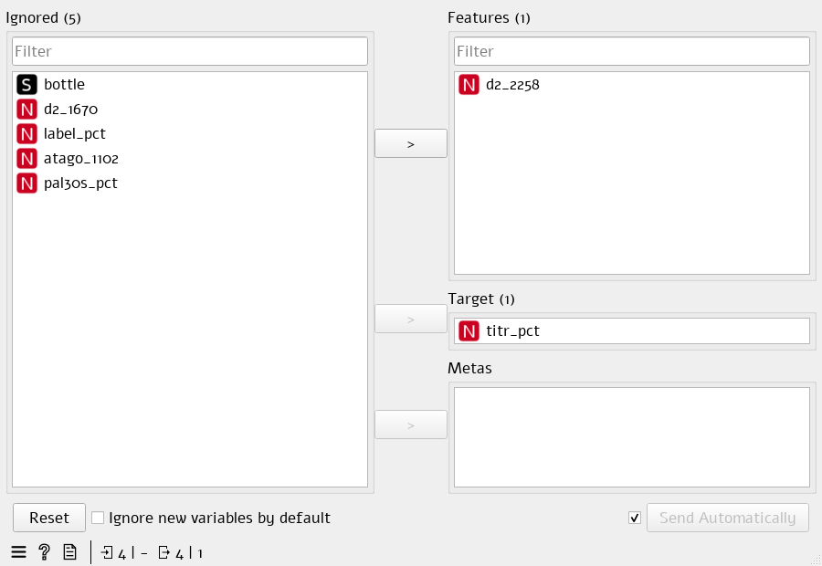
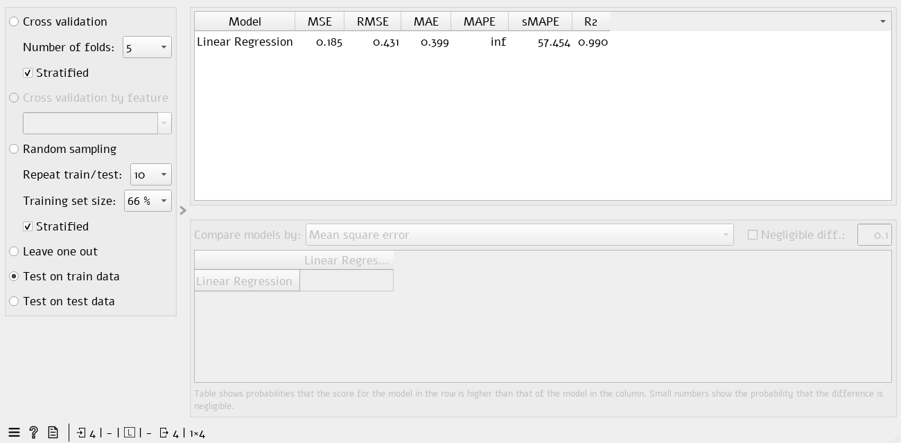
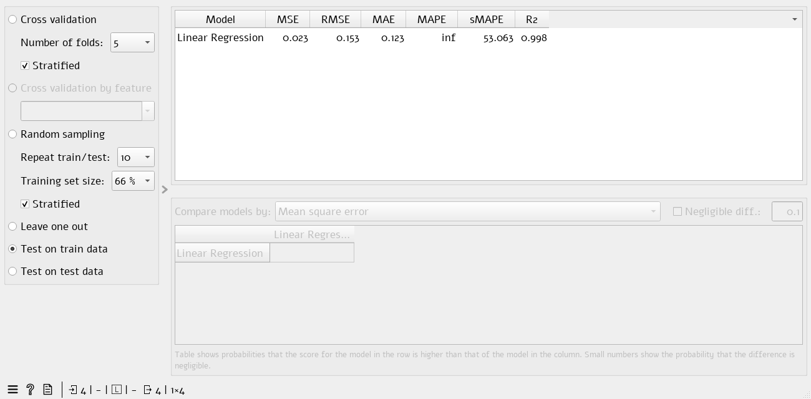

# 第 9 章 Orange 練習：方法確效報告（證據夠不夠？）

> 測試版本：**Orange 3.40.0**（本章**不需要** Spectroscopy 外掛）。
> 工作流程檔：`exercises/orange/ch09_validation.ows`；資料：`exercises/orange/ch09_validation.csv`（由 `exercises/orange/tools/make_ch09_validation.py` 產生）。
> 下文的 widget 名稱一律照 Orange 3.40.0 英文介面原文書寫，括號內是中文說明。
> 安裝 Orange 的步驟見 [README](README.md)。

第 9 章要回答：「1 mm、2258 nm 的二階導數 NIR 方法，現在能不能說『已確效』？」本章 Orange 只做其中**兩件**事：

1. 同一組光譜，換四種參考值（標示、Atago、滴定、PAL-30S），**R² 差多少**（選擇性與線性那一節）？
2. 同一組光譜，換四種參考值，**留一法的誤差（RMSE，單位 % 酸度）差多少**（準確度那一節）？

> **先講清楚幾件事**
>
> 1. **Atago = ATAGO PAL-Easy ACID 181，導電度式酸度計，不是折射計。** **PAL-30S 是折射計**（11/17 量），直接顯示酸度 %。
> 2. **n = 4（含水），R² 無法用來選參考方法。** 標示（0.996）與 PAL-30S（0.998）的 R² 都比滴定（0.990）高，Atago 最低（0.934）；同一組光譜只因換了參考值，R² 就從 0.93 變到 0.998。這代表參考值本身的誤差不同，不代表 NIR 變好變壞。
> 3. **兩個醋酸帶一致只是一致性，不是選擇性**（沒有測過糖等干擾物）。
> 4. **留一法的 RMSE 不是「準確度」。** 沒有獨立樣品；PAL-30S 的 0.24–0.26 % 只代表 NIR 與 PAL-30S 彼此一致。
> 5. **Orange 做不到的**：Fieller 預測區間、LOD / LOQ、確效總表（scorecard）、純誤差與缺適性的自由度——請到 R / Python（第 6 節）。

---

## 1. 開啟現成工作流程 ch09_validation.ows

1. **File → Open**，選 `exercises/orange/ch09_validation.ows`。
2. 畫布上有 15 個 widget：

```
File (ch09_validation.csv, 4 列)
   ├─ Data Table (validation)
   ├─ Select Columns (label)     ┬─ Test and Score LOO (label)     ┐
   │                             └─ Test and Score train (label)   │
   ├─ Select Columns (Atago)     ┬─ Test and Score LOO (Atago)     │  都接同一個
   │                             └─ Test and Score train (Atago)   ├─ Linear Regression
   ├─ Select Columns (titration) ┬─ Test and Score LOO (titration) │  （No regularization）
   │                             └─ Test and Score train (titration)│
   └─ Select Columns (PAL-30S)   ┬─ Test and Score LOO (PAL-30S)   │
                                 └─ Test and Score train (PAL-30S) ┘
```

3. 讀 **Test and Score train**（R2）與 **Test and Score LOO**（RMSE），與第 4 節的預期值對照。

**關於資料路徑**：`.ows` 裡的 File 存**相對路徑**（`ch09_validation.csv`，與 `.ows` 同一個資料夾）。把兩個檔案放在同一個資料夾就能開；File widget 顯示紅色錯誤時，雙擊它重新選檔。

---

## 2. 資料表長什麼樣

雙擊 **Data Table (validation)**：4 列（水＋3 瓶醋）。

| 欄位 | 角色 | 意義 |
|---|---|---|
| `bottle` | meta（文字） | water、vinegar_3%、vinegar_5%、vinegar_10% |
| `d2_2258` | **target** | 1 mm、第 1 次重複、SG（9 點、二次）二階導數 × 10³ 在 2258 nm 的值 |
| `d2_1670` | meta | 同上，1670 nm（另一個醋酸帶，要對照時用） |
| `label_pct` | meta | 瓶身標示 0 / 3 / 5 / 10 % |
| `atago_1102` | meta | ATAGO PAL-Easy ACID 181 的 11/02 讀值：0 / 3.32 / 4.87 / 7.45 |
| `titr_pct` | meta | 滴定酸度（NaOH 稱重配製、未標定、只做一次）：0 / 2.278 / 4.401 / 11.39 |
| `pal30s_pct` | meta | PAL-30S 折射計（11/17）：0 / 2.8 / 4.8 / 10.4 |

> 資料是確定性的（沒有亂數）：`d2_*` 由 `data/spectra_long.csv` 重算，與講義 `site/nir-pathlength/lib/ch09data.js` 用的是同一批。CSV 已存成帶 BOM 的 UTF-8；用別的編輯器改存時請選 **UTF-8 with BOM**。



---

## 3. 從零自己拉一次

### 步驟 1　File（讀檔）

- **File** 選 `exercises/orange/ch09_validation.csv`：4 instances、Numeric outcome（`d2_2258`）、其餘 6 欄是 meta。

### 步驟 2　Select Columns（選欄位）：訊號當特徵、參考值當目標

- 拖一個 **Select Columns**，從 File 連過來。把 `d2_2258` 放進 **Features**，把其中一種參考值（例如 `titr_pct`）放進 **Target**，其他全部放到 **Ignored**，**Metas** 清空。
- 一共要 4 個 Select Columns，Target 分別是 `label_pct`、`atago_1102`、`titr_pct`、`pal30s_pct`。



> **為什麼訊號當特徵、參考值當目標？** 這樣 Orange 的誤差（RMSE）**單位就是 % 酸度**，可以直接和「半寬 ±0.5 %」的目標比。如果反過來（參考值當特徵、訊號當目標），RMSE 的單位是訊號（×10⁻³），不能直接比。

### 步驟 3　Linear Regression（線性迴歸）

- 拖**一個** **Linear Regression**：**Regularization** 選 **No regularization**，**Fit intercept** 打勾。它的 **Learner** 輸出同時接到下面 8 個 Test and Score。

### 步驟 4　Test and Score（測試與評分）

- 每種參考值各拖兩個 **Test and Score**：**Data** 接該參考值的 Select Columns、**Learner** 接 Linear Regression。
  - 一個左側選 **Test on train data**：讀 **R2**（= 校正 R²）。
  - 一個左側選 **Leave one out**：讀 **RMSE**（留一法誤差，% 酸度）。

---

## 4. 我們從結果讀出什麼

### 4.1 R²：和講義完全一樣

**Test and Score train**（Test on train data）的 R2：

| 參考值 | Orange R2（2258 nm） | 講義 `CH9.spec.r2` |
|---|---|---|
| 標示 `label_pct` | **0.9955** | 0.9955 |
| Atago `atago_1102` | **0.9342** | 0.9342 |
| 滴定 `titr_pct` | **0.9898** | 0.9898 |
| PAL-30S `pal30s_pct` | **0.9984** | 0.9984 |

單一特徵、有截距的直線，R² 就是兩個變數相關係數的平方，不管誰當 x、誰當 y 都一樣，所以 Orange 與講義**完全相同**。把 Features 改成 `d2_1670`，會得到 0.9448 / 0.9866 / 0.9983 / 0.9990（Atago / 滴定 / 標示 / PAL-30S），也與講義一致。





讀法：**R² 的排序（PAL-30S > 標示 > 滴定 > Atago）反映的是參考值的品質，不是 NIR 的品質。** 所以 n = 4 的 R² 不能拿來決定「用哪個參考方法」。

### 4.2 留一法 RMSE：數字與講義**不同**，但結論一樣

**Test and Score LOO**（Leave one out）的 RMSE（單位 % 酸度）：

| 參考值 | Orange 留一法 RMSE（直接迴歸） | 講義 RMSECV（反向校正） |
|---|---|---|
| Atago | **2.198** | 2.182 |
| 滴定 | **1.225** | 1.152 |
| 標示 | **0.666** | 0.677 |
| PAL-30S | **0.239** | 0.256 |

- **Orange 擬合 `參考值 = a + b × 訊號`（直接迴歸），講義擬合 `訊號 = a + b × 參考值` 再把留下那瓶的訊號換算回濃度（反向校正）。** 兩者的 R² 相同，但留一法每次留一瓶、只用 3 點擬合（自由度 1），斜率對留下哪一瓶很敏感，所以 RMSE 不同（差 1–7 %）。
- **所以：Orange 重現講義的 R²，不重現講義的 RMSECV。** Orange 的留一法 RMSE 我們另外用 numpy 做同一套直接迴歸驗證過（完全相同）；講義的 RMSECV 要用 R / Python 練習（`ch09_validation_report.R`）才算得出來。
- 排序與結論不變：Atago（2.2）≫ 滴定（1.2）> 標示（0.67）> PAL-30S（0.24）。同一組光譜，RMSE 隨參考值改變 9 倍，所以**留一法 RMSE 的大小主要反映參考值的品質**。
- 注意：Test and Score 在 **Leave one out** 下的 **R2 是留一預測值的 R²**（例如滴定 0.917、Atago 0.336），不是校正 R²；校正 R² 看 **Test on train data**。


### 4.3 這些數字能說什麼、不能說什麼

- 能說：1 mm、2258 nm 的二階導數與各種參考值在這 4 點上都呈線性（可行性研究的初步證據）。
- **PAL-30S 的 0.24–0.26 % 很小，只是 NIR 與 PAL-30S 彼此一致**（consistency），不是準確度（accuracy）；沒有獨立樣品，也沒有標定過的滴定。
- 第 4 章 PLS 的 RMSECV 是 0.317 %，比 Atago 自己兩天的差異 SD（0.41 %，第 8 章）還小——NIR 預測得比參考方法自己重複的結果還一致，是**過度配適**的徵兆（這兩個數字 Orange 不在本章算：PLS 見第 4 章；Atago 兩天的差異見第 8 章）。
- 不能說：「方法已確效」、「準確度是 x %」、「可取代滴定」。

---

## 5. 常見陷阱

1. **Select Columns 的 Features 放了參考值**：Features 只該有 `d2_2258`（要看 1670 nm 就改成 `d2_1670`）。多放了欄位，R² 是多個特徵的，對不上表中的數字。
2. **把 Orange 的 RMSE 直接當成講義的 RMSECV**：兩者做法不同（直接 vs 反向校正），差 1–7 %；比較時請標明用哪一種。
3. **Leave one out 的 R2 當成校正 R²**：校正 R² 要切到 **Test on train data**。
4. **Linear Regression 的 Regularization 沒選 No regularization**：Ridge / Lasso 會把斜率壓小，R² 與 RMSE 都會變。
5. **在 4 個點上讀太多**：只有 4 點、每次留一瓶後只剩 3 點（自由度 1）；PAL-30S 的 RMSE 小不代表準。

---

## 6. Orange 做不到的部分，請到 R / Python

| 想做的事 | Orange | R / Python（`exercises/ch09_validation_report.R`、`.ipynb`） |
|---|---|---|
| 換參考值看 R²（選擇性與線性那一節） | **Select Columns**、**Test and Score**（本章） | 同上（兩個譜帶 × 四種參考值，共 8 個 R²） |
| 留一法 RMSE（% 酸度） | 有，但是**直接迴歸**，與講義的反向校正 RMSECV 不同（見 4.2） | 反向校正的 RMSECV（講義數字：2.182 / 1.152 / 0.677 / 0.256） |
| 預測值的 **Fieller 預測區間**（現在半寬 3.14 %、下一次 0.13–1.3 %、示意目標 0.5 %） | **沒有**（Orange 只有點預測，第 5 章已提過） | 有（現在 vs 下一次實驗 vs 目標的比較圖） |
| **LOD / LOQ**（殘差法 3 s / \|b\|、10 s / \|b\|；儀器雜訊法） | **沒有** | 有（滴定 1.8 / 6.1 %、Atago 3.0 / 10.1 %、儀器雜訊 0.8 / 2.7 %） |
| 純誤差與缺適性的自由度（現在 0；下一次 8 × 3 為 16 與 6） | 沒有 | 有 |
| **確效總表**（8 項，狀態、現在的證據、怎麼補，後兩欄留給學生填） | **沒有** | `exercises/ch09_validation_scorecard.csv` |
| 報告範本 | 沒有 | `exercises/ch09_validation_report_template.md` |

本章 Orange 做得到的是「**看見**同一組光譜換參考值，R² 和留一法誤差會怎麼變」；預測區間、LOD / LOQ 與確效總表要接著做 R / Python 練習。
做完第 7 章的實驗後，把新結果補進 `ch09_validation_report_template.md` 與 `ch09_validation_scorecard.csv`。
